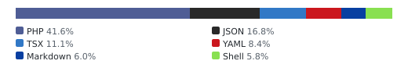
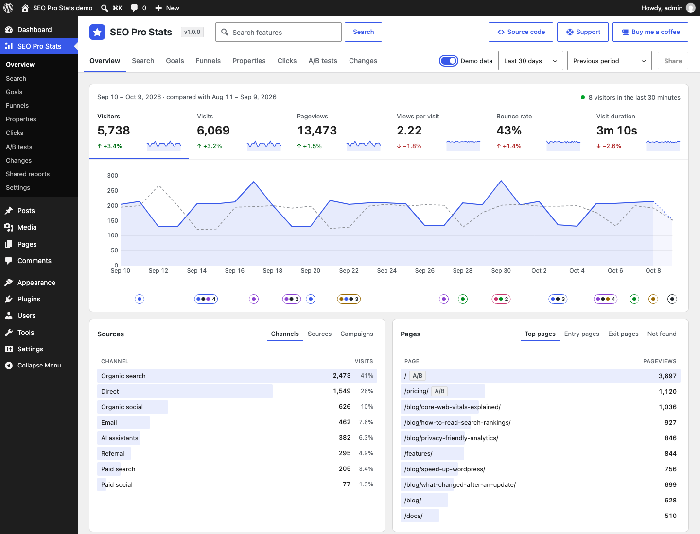
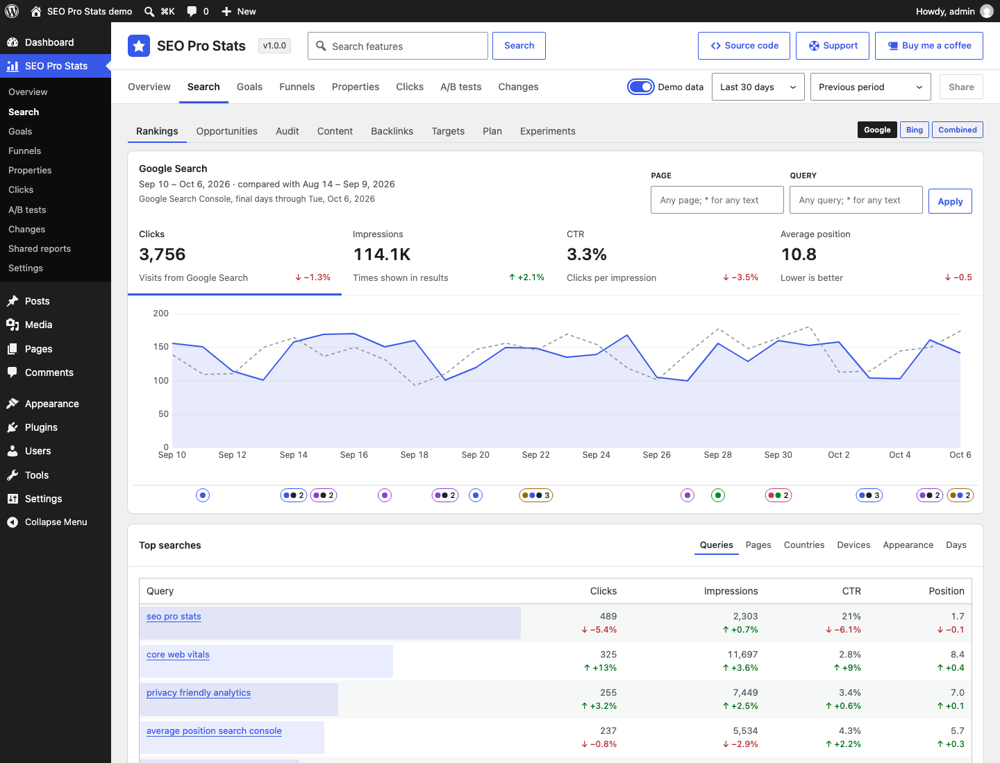
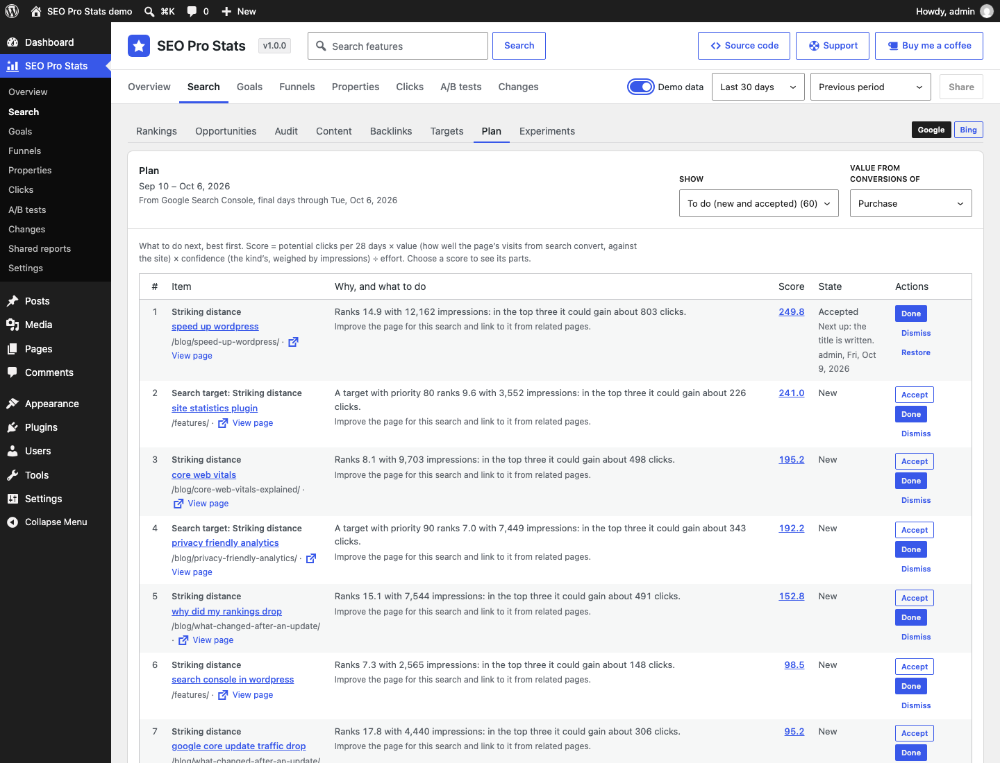
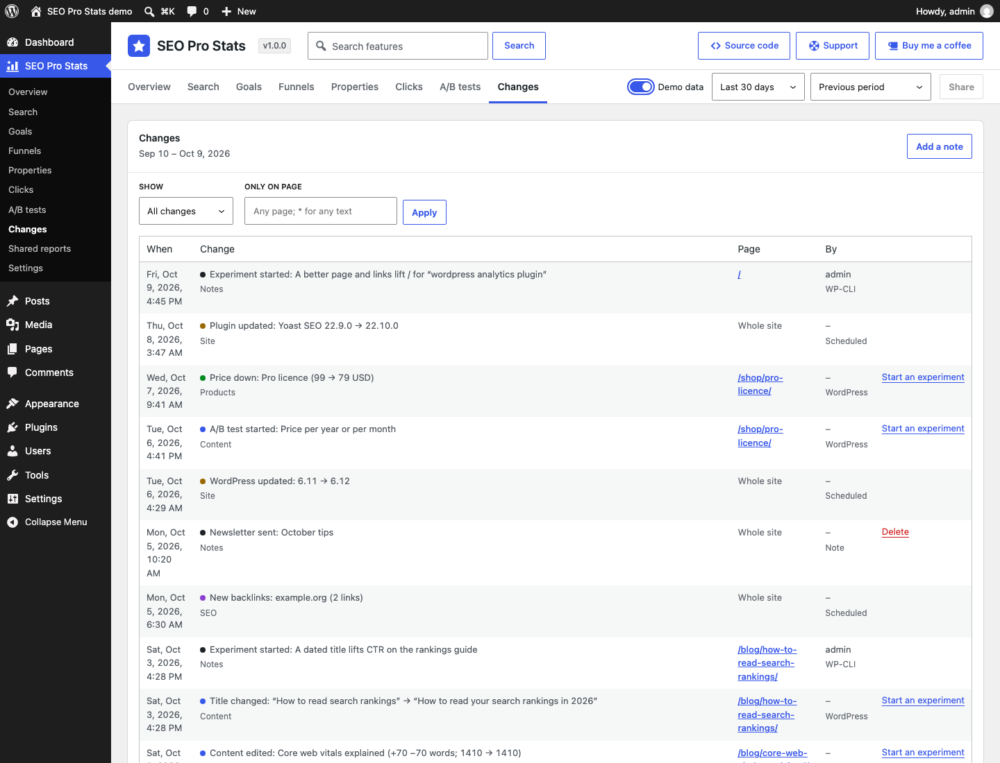
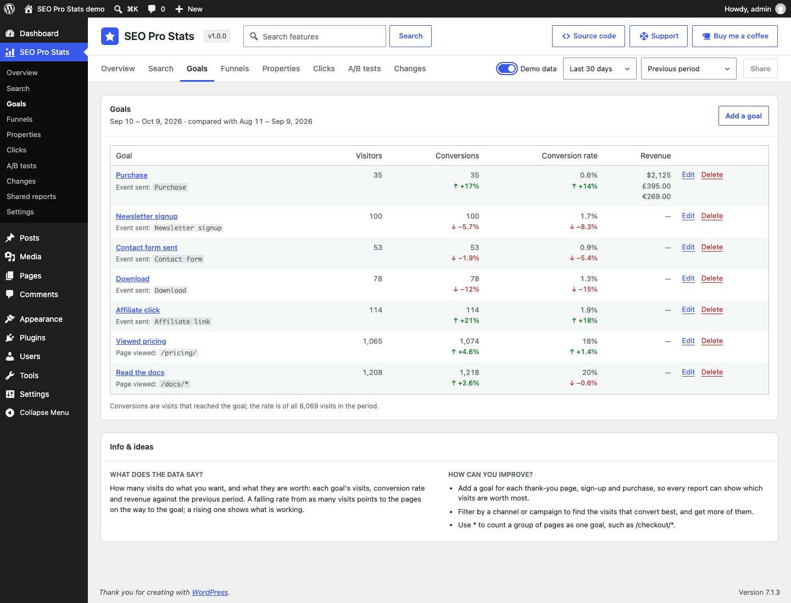
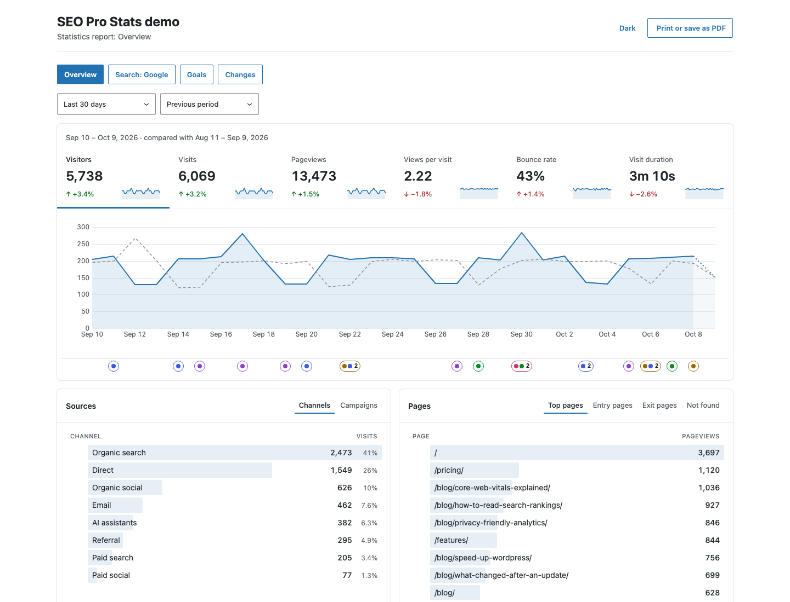
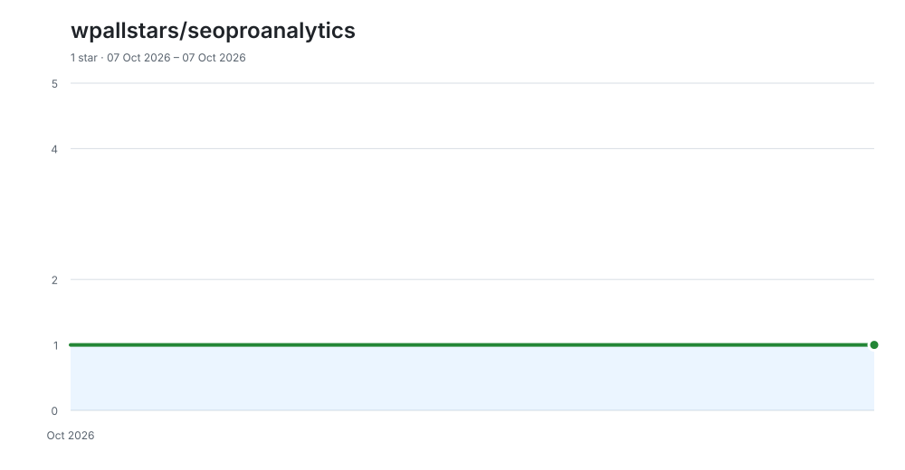

# SEO Pro Analytics

<!-- aidevops:badges:start -->
<!-- On GitHub only: the Read Me tab skips this block. scripts/rename-plugin.sh rewrites it. -->
[](https://github.com/wpallstars/seoproanalytics/actions/workflows/ci.yml)
[](https://sonarcloud.io/summary/new_code?id=wpallstars_seoproanalytics)
[](https://app.codacy.com/gh/wpallstars/seoproanalytics/dashboard)
[](https://www.codefactor.io/repository/github/wpallstars/seoproanalytics)
[](https://scorecard.dev/viewer/?uri=github.com/wpallstars/seoproanalytics)
[](LICENSE)
[](https://github.com/wpallstars/seoproanalytics/releases)

[](readme.txt)
[](readme.txt)
[](readme.txt)
[](docs/metrics/repo-metrics.md)
[](docs/metrics/repo-metrics.md)

[](docs/metrics/repo-metrics.md)
<!-- aidevops:badges:end -->

**Actionable analytics for WordPress. Connect your content to the data that shows you how to grow.**

Most statistics plugins count what happened. SEO Pro Analytics also shows why, and what to do next. It puts your traffic, search rankings and sales on one timeline with every change made to the site (a post edited, an SEO title rewritten, a price cut, a plugin updated, a Google update rolling out), turns what it finds into a ranked plan of search work, and checks each change you make against the pages you did not change, so you know what worked.

It counts visits in your own WordPress database, with no cookies, no stored IP addresses and no outside service. People read it in wp-admin; scripts and AI agents read the same reports through the REST API, WP-CLI (`wp seoproanalytics`) and, on WordPress 6.9 and later, abilities.

If this saves you time, headaches and costs, feel free to [buy me a coffee](https://buymeacoffee.com/marcusquinn), or whatever you like, to invest in making more things open-source.

Version: 1.20.3

<!-- github-only:start -->
## Screenshots

**Visitors**: visits against the previous period, the visitors on the site now, and the site's changes marked under the chart.



**Search → Rankings**: Google Search Console and Bing Webmaster Tools clicks, impressions, CTR and position by query and page.



**Search → Plan**: search work from every report in one list, best first, with its score.



**Changes**: what changed on the site, when and on which page.



**Goals**: conversions, conversion rate and revenue per currency, against the previous period, with what the figures say and how to improve them.



**A shared report**: the sections you chose, read-only for a client or colleague, without wp-admin, ready to print or save as PDF.


<!-- github-only:end -->

## Why SEO Pro Analytics

- **Cause and effect on one timeline.** The change log records what changed on the site as it is saved (content, SEO titles and descriptions, prices and stock, plugins, themes and settings) with Google's search updates and your own notes, and marks it under every chart. A rise or a drop comes with the changes around it.
- **Your content joined to its results.** Each page's search clicks, position and CTR sit beside the visits from search it started, how long they stayed and how many reached a goal, so you can see which content earns traffic and which earns revenue.
- **A plan, not just a report.** Search → Plan ranks the work worth doing from your own data: striking-distance queries, titles searchers skip, pages losing clicks with the likely cause, words a page is missing, pages competing for one search, audit findings, internal links and pages search does not show. Each item says why it is listed and what to do, with the clicks it could bring, weighted by how well the page converts.
- **Proof of what worked.** Mark a change done and an experiment compares its pages before and after against the pages you did not change, then suggests keep, revise or undo. A/B tests of blocks in the editor compare versions of a page live, without cookies.
- **Private by design.** No cookies or browser storage for visitors, no stored IP addresses, no visitor identity across days, and no database query on visitors' pages. Outside services are off until you connect them.
- **Ready for AI agents.** Every report is in the REST API, WP-CLI and WordPress abilities, and the SEO loop export gives an agent one cycle of work: the plan, the experiments due and their results. Reviewed change sets can apply title and description edits and restore them on an undo decision; nothing changes without an explicit request.

## Getting started

1. **Install and activate** SEO Pro Analytics, then open it in the admin menu, under Dashboard. Visits show within a minute or two; open the site logged out to make some. Until there are enough, switch on **Demo data** at the top of the screen to try every report.
2. **Say what counts as a conversion** under **Goals**: a thank-you page, a signup event, a purchase. Paid orders from WooCommerce, Easy Digital Downloads and FluentCart are recorded by themselves; ThriveCart needs its webhook (Settings → Tracking).
3. **Connect your search data** under **Settings → Connections**: Bing Webmaster Tools, and Google Search Console with the SEO Pro Analytics Connect add-on, with the 16 months of history they keep.
4. **Bring your history across** from another statistics plugin under **Settings → Import**, so the charts start before SEO Pro Analytics did.
5. **Work the plan**: open **Search → Plan**, do the top items, mark each done, and read its result in **Search → Experiments** on its review day.

## What's included

### Page experience (Chrome UX Report)

Field data comes from the Chrome UX Report connection of the SEO Pro Analytics Connect add-on (below), or from the demo data. Search → Audit → **Page experience** lists monitored pages with their field metrics, search clicks and visits; pages with a poor p75 for LCP, INP or CLS come first. Visitors and Search → Rankings can show the origin's p75 history by metric and form factor. Each point covers a rolling 28-day window, not that day's traffic alone. Missing records mean insufficient eligible Chrome traffic or an uncompleted check, never a zero or a passing score; old samples are marked stale.

Poor pages receiving search clicks also enter Plan as an audit item. Its score uses 10% of observed clicks per 28 days (at least one), conversion value, confidence 0.5 and effort 2: a prioritisation estimate, **not a prediction of extra clicks or rankings**. A change in LCP, INP or CLS classification adds a `vitals_status` marker to the site group.

The report is also available as REST `GET /vitals`, `wp seoproanalytics vitals [<page>] [--data=demo]`, and ability `seoproanalytics/vitals`; shared report links do not expose it. Field samples stay in the site's database for 400 days.

- **Statistics without cookies**: visitors, visits, pageviews, bounce rate and time, sources and campaigns, pages and pages not found, site searches, countries on a map, devices and events, against the previous period. Visits are counted with a hash salted each day; no IP address is stored and visitor pages run no database queries.
- **Goals, Funnels, Properties and Purchases**: conversions and revenue per currency, from pages, events and paid orders in WooCommerce, Easy Digital Downloads, FluentCart and ThriveCart, with refunds and renewals.
- **Clicks**: what people click, dead clicks, links followed, files and forms sent, never what anyone types.
- **Changes**: a log of what changed on the site, search engine updates and your notes, under every chart.
- **Search**: Bing Webmaster Tools, and Google Search Console with the add-on, with Rankings, Opportunities, Content, Audit (with internal links, indexation and Google's URL Inspection), Backlinks, Targets, Plan, Experiments, and A/B tests of blocks.
- **Moving from another plugin**: imports history from Burst Statistics, Koko Analytics, Statify, WP Statistics, Independent Analytics, Slimstat, Matomo for WordPress and Jetpack Stats, then removes what it left behind.
- **Shared reports** for clients, **demo data** to try every report, and the same reports for scripts and AI agents through the REST API, WP-CLI and abilities.

## User guide

### Alerts

**Settings → Alerts** emails when statistics are at risk, on by default to
the site administration email. Enter addresses one per line to use other
recipients (up to twenty); invalid addresses are ignored. Choose which
alerts email, or turn email off without hiding health notices.

Alerts cover visits stopping for 24 hours on a site averaging at least
20 pageviews a day over its last seven summarised days, late or missing
scheduled jobs, daily summaries falling behind, an unavailable collector,
a connected source's same error lasting three days, and failed report emails
when scheduled reporting is available. Jobs and collector problems must
persist for an hour before emailing. Quiet sites and tracking turned off
never trigger the visits-stopped alert.

Checks run hourly and on admin visits at most once an hour, even if cron
has stopped. One combined email per hour at most gives each problem, when
it was first seen and what to do. Unfixed alerts remind you weekly; emailed
alerts get one recovery email, which may wait for the hourly allowance.
Failed sends retry next hour. Open alerts appear on this plugin's screens;
recoveries stay available for seven days. Nothing runs on visitor pages.

Administrators and agents read the same stored state with `GET /alerts`,
`wp seoproanalytics alerts --format=json` or ability `seoproanalytics/alerts`.
`wp seoproanalytics alerts --run --user=1` also checks and sends due emails;
`wp seoproanalytics doctor` lists open alert keys.

**Edit** links open the editor in a new tab, like **View page**, so the report
stays open with its period and filters. This applies to page rows in Search,
Clicks and Opportunities, the page heading in Search, and the page of an A/B
test. Edit appears only when you have permission to edit that page.

### Visitors

**SEO Pro Analytics** in the admin menu, under Dashboard, opens on **Search** (below), the first tab. The second tab, **Visitors** (its address stays `#/overview`, so older bookmarks and shared reports still open it), shows the visitors in the last 30 minutes (beside the period, refreshed every 30 seconds), then visitors, visits, pageviews, views per visit, bounce rate and visit duration against the previous period, a chart of the one you pick (the day, hour or month still being counted is dotted), where visits came from, what they viewed (with the addresses that were not found, to find broken links), views by author, category and post type, what people searched the site for and which searches found nothing, where (with a world map shaded by visits; choose a country to filter by it) and on what (and whether logged in), and their events with the share of visits that had each. Choose a period and comparison at the top; before you choose one, it opens on the last 13 weeks against the previous period. The periods are grouped: Days (today, yesterday, the last 24 hours, the last 7 days), Weeks (the last 4, 13, 26 and 52 weeks; with the last 7 days, these are whole weeks, so the previous period starts on the same weekday and weekends meet weekends), Calendar (this week, month and year, the last 12 months, last year), then all time and custom dates; choose any row to show only those visits, and choose it again (or use the bar above the chart) to remove the filter. Tabs at the top, also in the menu, open the other sections, below.

Comparisons line up the cycles that move traffic, so a change is not just a different mix of weekdays. **Previous period** is the period just before; for this week, month or year so far it is the same part of the previous one (Monday to Wednesday against last Monday to Wednesday, the 1st to the 11th against the previous month's 1st to 11th). **A week earlier, same weekdays** moves the period back a week. **A month earlier** has two: **same weekdays**, the same weekday and week of the month (the second Sunday against the previous month's second Sunday), or **same dates**. **A year earlier** has two too: **same weekdays**, 52 weeks back, so a Sunday meets a Sunday in the same week of the year, or **same dates**. The menu names the days each comparison means (on Search, the line under the tiles does, as its periods end at the newest search day), and leaves out one that would overlap the period or repeat another. Today and Yesterday start against the same weekday a week earlier; other periods against the previous period. Changing the period keeps a comparison you chose while it suits the new period.

**Typical period**, in Visitors for whole-day periods up to 28 days, compares with the average of four earlier periods on the same weekdays. Today meets the four earlier same weekdays; the last 28 days meets four earlier 28-day periods. Each shift is the period's length rounded up to whole weeks, so periods never overlap. The chart shades their lowest to highest values behind the average line; the tooltip shows the band. Counts can be fractional; rates are calculated from summed counts, not averaged rates. An unfinished period meets the same elapsed part of each earlier period. Missing history counts as zero. Other sections show no comparison when Typical period is selected.

Under the Visitors chart, a lane marks the changes in the period, coloured by group; changes closer than a marker's width share one with their count. Hover over or focus a marker to list its changes, use the arrow keys to move between them, and choose one to read its changes in a window (close it with Close or Escape), with **Open in Changes** for the same days and page. With the reports filtered to one page, the lane shows that page's changes and the site-wide ones.

The main charts (Visitors, Search → Rankings and Page experience) open with the **Trend** switch at its top right on **Short** (a 1-week against a 13-week moving average), or **Long** (4 against 52 weeks) on monthly charts, which have no Short. Choose **Off**, Short or Long to change it while you look at that chart; leaving the section and coming back starts on the default again, so a trend switched off for one look is not left off by mistake.

After you choose a named period and comparison, the admin menu opens on your
last choice instead of Last 13 weeks against the previous period. Each person
has their own choice; custom dates are not remembered. A period or comparison
in a link or bookmark always wins. Shared reports keep their own periods.

At the bottom of each section (and each Search tab), **Info & ideas** answers two questions: **What does the data say?** (how to read the section's figures and what they point to) and **How can you improve?** (three things to do about it). Shared and printed reports leave it out.

Goals and funnels belong to the data you are looking at: demo data has example ones of its own. The period, comparison and filters stay as you move between sections. The address keeps the view, so it can be bookmarked and the back button undoes a change. A **Dashboard widget** shows today so far and the last 7 days; it starts at the top of the right-most column, and stays where you put it once you move a box.

When SEO Pro Stack makes wp-admin dark, the widget's headings, labels and unchanged, positive and negative figures use readable light colours. Its light-mode colours are unchanged.

### Search

**Search → Rankings** shows search clicks, impressions, click-through rate (CTR) and average position from Google Search Console (and Bing Webmaster Tools, below) for the period, against the previous one, with a chart of the one you pick (and the changes lane under it), then the search queries, pages, countries and devices, most impressions first. Choose a column's header to sort by it (the first click puts the most first, or the best position; a second click reverses it); the address keeps the order. Choose a page to list the queries it showed for, or a query to list the pages it showed; choose it again to go back. The period stops at the newest day Search Console has made final (about three days ago), and the comparison has as many days, so days not imported yet never look like a drop. A lower position is better. Until Search Console is connected, it links to Settings → Connections; demo data has made-up search data to try it with. With Bing Webmaster Tools connected too, **Google** and **Bing** buttons at the end of the tabs switch every Search tab to that engine (the address keeps the choice). Bing gives its pages and queries by week and no countries or devices, so with Bing the period is whole weeks ending on Bing's newest week, and a page's or query's chart is by week. With both, a **Combined** button adds them up on Rankings, Opportunities and Content: clicks and impressions summed, CTR and position over both, a query or page shown on both as one row, and the period ending at the earlier of their newest days, in whole weeks (each engine counts its own days: Google's in Pacific time, Bing's in UTC).

**Search → Rankings → Appearance** shows Google Search Console clicks,
impressions, CTR and average position by result type, such as video,
product snippets, review snippets and forums, with the comparison period.
It appears for the whole site and Google only; the address keeps the tab.
One search can show several appearances, so these figures do not add up
to the site's totals. New types returned by Google are imported too.
Imports resume in the background and can be undone; demo data includes
made-up appearance days. Scripts and AI agents use REST `search?kind=appearance`,
`wp seoproanalytics search appearance --data=demo --range=30d --compare=prev --format=json`,
or the `seoproanalytics/search` ability with `kind: appearance`.

**Search → Rankings → Days** lists the chart's points as a table, newest
first: clicks, impressions, CTR and average position for each day, or each
week or month when the chart shows those. It works for Google, Bing and
Combined, and for one page or one query; Newer and Older page through long
periods. The comparison stays on the totals, not on each row. Scripts and AI
agents use REST `search?kind=days` (each row has `from` and `to`),
`wp seoproanalytics search days --range=90d --limit=100 --format=csv`, or the
`seoproanalytics/search` ability with `kind: days`; `offset` reads the next rows.

#### Opportunities

**Opportunities**, beside Rankings, says where search work pays:

- **Striking distance**: a page's queries at positions 4–20, with the clicks each could gain in the top three, at the CTR this site gets there.
- **Low CTR**: queries in the top 10 that searchers choose much less often than this site's own CTR at that position; a clearer title and description may win the missed clicks.
- **Losing clicks**: pages with at least a fifth fewer clicks than the earlier period, each with the likely cause (it ranks lower, it is searched for less, fewer searchers choose it, or it is no longer shown), the queries that lost most and what changed on the page, plus the search engine updates in the two periods.
- **Missing from the page**: queries a page ranks for in the top 20 whose words the page does not have, or has only some of, with the words missing; questions are marked.
- **Overlapping pages**: queries for which two or more pages each get at least a tenth of the impressions, with each page's share, position and clicks, and whether the page with most impressions changed between the halves of the period. These are candidates to review, not faults: a guide and a product page can both be right for one search. If the pages answer the same need, make one the clear answer and link to it from the others.

Choose a row to open it in Rankings. Expected CTR is measured from the site's own search data, with a cautious default where it has too few impressions; at most the newest 366 days of the period are read.

#### Audit

**Audit**, after Opportunities, checks what WordPress says about each published page: its title and description (your SEO plugin's, or the post's own title and excerpt), its headings, length and images, and whether it asks search engines not to index it or names another page as canonical. It lists the pages with a finding, most search impressions first (choose a search figure's header to sort by it instead), so the fixes that matter most are at the top: a title over 60 characters, missing or the same as another page's; a description over 160 characters, missing or shared; no H1 or several (themes show the title as one); images without alt text; thin content (under 300 words, shown in search but never clicked); and noindex or a canonical address elsewhere on a page that still shows in search. Pick a finding to list only those pages. Pages are read when they are saved, and the rest in a daily batch of 200 (each again within 30 days), never while visitors browse. Titles, descriptions, noindex and canonical come from Rank Math, Yoast SEO, SEOPress or All in One SEO when one is active.

Under the findings, **Internal links** lists **orphan pages**, **converting pages with few links in** (3 or more conversions from search, 2 or fewer linking pages) and **missing links** between pages showing for the same search. When the newest imported crawl includes an all-links export, orphan and converting lists use incoming counts **as served**, including menus, footers and widgets. Rows show served and **in text** counts; text counts remain the fallback without crawl counts. Missing-link suggestions still inspect post text. The front page is left out of orphan and converting lists.

**Crawl reachability** adds **unreachable** pages: published, indexable pages a confirmed complete crawl did not reach, and **deep** pages: four or more clicks from the crawl start with search impressions or conversions. Both feed Audit and Plan. Tick **This crawl covered the whole site** only for an upload that did not stop at a page limit; otherwise unreachable findings are skipped with an explanation. Site crawl shows incoming served/body counts and depth. Clicked outbound and affiliate destinations include redirects, with hop count and final address when exported, sorted by clicks. Only failing and redirecting link rows remain after import; a full link graph is never retained.

Below that, **Indexation** lists what search does not seem to show: **published pages** with no search impressions in the newest 28 days of search data, published before them (noindex pages and pages whose canonical is elsewhere are left out), and **other sitemap addresses**, the category, tag and author archives and other plugins' addresses in WordPress's own sitemap, listed that long with none. Each row says whether search never showed it or showed it before and when it stopped, with its age, words and links in. The sitemap is read once a day from WordPress, with no outside request; when an SEO plugin replaces WordPress's sitemap, only published pages are listed. With Google Search Console connected, each row also gives Google's own reason (such as "Crawled - currently not indexed") and its last crawl.

Last, **Google's index** (Search Console only) shows the sitemaps submitted in Search Console as Google read them, with their errors, warnings and when Google last downloaded each, and warns when the site's own sitemap is not submitted; and the pages Google's URL Inspection has checked, newest first, with Google's verdict, reason, last crawl and a link to the inspection in Search Console. The hourly import inspects up to 200 pages a day (Settings → Data → Google URL inspections, 0 to 2,000, Google's own limit): first those Indexation lists, then pages with search traffic, each again after 14 days. Four audit findings come from it: **blocked by robots.txt**, **crawled, not indexed**, **Google picked another canonical** and **rich result errors**; sitemap problems go to Plan.

With Bing chosen, **Bing's crawl** (Bing Webmaster Tools only) lists the addresses Bing reports a crawl issue on, errors first, then those with most links to them: client and server errors, blocked by robots.txt, DNS failures, timeouts and malware, and redirects (listed, not errors). Below are Bing's crawl by day for the last two weeks, the sitemaps Bing has and the URL submission quota. It is read once a day in the hourly import. A crawl error on a published page is the audit finding **Bing crawl error**, and so a Plan item.

**Site crawl** shows what your pages actually served to a crawler, after the theme, plugins, caching and the host had their say, which WordPress's own settings cannot tell. SEO Pro Analytics never crawls unless **Crawl this site** is on (see Built-in site crawl below). Alternatively, crawl it with LibreCrawl, the aidevops site crawler or any crawler that exports CSV or JSON, then import the exports in **Settings → Import → Site crawl** (up to 10 files of one crawl, 50 MB each, 200,000 pages and 500,000 links). Each crawler's own column names are recognised; a file with an address column is pages, one with source and target columns is links. Only the site's own pages and the links that fail or redirect are kept. Pages are kept by their path, so an address with a query string (a `?replytocom=` reply link, a `?page_id=` short link) is left out with the links found on it, and a link to one counts as a link to its path. Site crawl then lists **pages** with a problem (client or server errors, no answer, served with noindex, a canonical pointing elsewhere, no title), **links** from your pages that fail or redirect (with where they are and their text) and **clicked destinations**: outbound and affiliate links people clicked in the period whose crawl answer failed, with the pages they were clicked on. Five audit findings come from it: **crawl error**, **served noindex** and **served canonical elsewhere** (only where WordPress does not ask for it), **broken links** and **internal links through redirects**; each is a Plan item, and so is each broken clicked destination, scored by its clicks and what its page converts. When a page's answer, noindex or canonical changes between two imports, a **Served** change goes on the timeline. Import a new crawl to replace the old one; Undo deletes an import's rows.

**Blocked external links** (401, 403, 429 or 999) are separate from broken links: the linked site refused the crawler; check by hand. In Site crawl's links list, choose **Blocked**, or read `GET /crawl?kind=links&status=blocked`, `wp seoproanalytics crawl list --kind=links --status=blocked --format=json`, or the crawl ability with `kind: links, status: blocked`. Rows keep their original status and return `answer: blocked`, `blocked: true`, `failed: false`; `counts.blocked_links` is separate. They do not affect broken-link Audit findings or Plan items, including clicked links. Internal errors still count as failures. Existing rows reclassify without another import.

**Crawl trends** compares saved totals from completed imports: a small line for each finding and HTTP status class, with first and last dates and counts. Crawl tables keep the latest state only, not copies of every crawl. **Settings → Data → Crawl import history** keeps import records and totals for 13 months by default (the newest and any still used by the latest crawl always stay); Served changes stay on the timeline. Settings → Data also lists estimated crawl table rows and allocated data/index space, refreshed daily, as does `wp seoproanalytics doctor`. `GET /crawl/imports` and `wp seoproanalytics crawl imports` return the totals; `GET /crawl` and `seoproanalytics/crawl` include the trend. Older imports made before totals were saved are not shown as zeros. Historical totals remain as recorded, including the earlier broken-link classification.

**Verify crawl fixes**: mark a crawl finding done in Plan, then import a fresh crawl covering that page. The item is **Confirmed** when the finding is gone, or **Reopened** immediately when it remains, with the crawl date in its note. Both appear in the Done view; reopened items also appear in To do. Missing observations do not confirm a fix. With the Crawler connection, Done queues a check of that page: cron batches items on the same page for an hour, starts at most 20 checks a day, and requests depth 1, at most 100 addresses and no sitemap discovery. The card shows the queued count.

These checks import **partial** crawls: only covered pages and their outgoing links change; other findings remain. Partial totals stay in import history, never the whole-site trend, and cannot establish whole-site coverage. REST and the crawl-import ability accept `partial: true`; WP-CLI uses `crawl import --partial`. Undo restores the replaced rows and crawl verdicts while preserving later owner actions. Undo staging is single-step: undo before starting another import. A targeted check cannot establish discoverability or whole-site depth; use a normal crawl for those findings.

**Served text** adds two more crawl findings: **served title differs** (including an empty title or only the site name) and **served description differs or is missing**. Both become CTR Plan items on pages with search impressions. A title that includes the stored title with the site's name before or after it is accepted. Site crawl filters these findings and shows **As served** beside **Stored in WordPress now**. Empty text is labelled separately from text not observed or not kept. Only up to 500 flagged pages per import retain text; other pages keep compact hashes. If an export includes H1 observations, the audit uses those instead of assuming the theme prints the title. LibreCrawl's first-H1 string establishes presence only; counts, lists and numbered columns can detect several. A changed title or description makes a Served timeline entry with its new text, and its earlier text only when retained; all Served entries share the 500-per-import cap. Import another crawl to verify a fix.

#### Content

**Slowest that matter** in Site crawl lists slow pages with visits in the chosen period, by conversions when a goal exists, otherwise visits. It shows the crawl response time, HTML bytes and fresh page-level field TTFB/LCP when known. Slow timing needs two imports in a row unless field data agrees; HTML over 1 MiB also qualifies. Non-poor field data wins over a slow crawl. These are Audit findings and Plan items, not estimates of revenue lost: timings are **as the crawler measured**, affected by its location and load. Import totals keep median and 90th-percentile response times for trends; confirmed timing changes appear on the timeline. Read the same list with `GET /crawl?kind=pages&finding=slow`, `wp seoproanalytics crawl --finding=slow --format=json` or `seoproanalytics/crawl` with `finding: slow`.

**Content**, after Audit, sets each page's search impressions, clicks, position and CTR beside the visits from search that started on it (from any search engine, so the two differ), their bounce rate and time, and how many reached a goal (pick which; the first by default). A page that ranks but whose visits leave needs better content or a clearer next step; one that converts but gets few clicks is worth ranking higher. Pages come most impressions first; choose any column's header to sort by it, and again to reverse it. Choose a page to open it in Rankings. The visits come from the daily summaries; after an update, older days are added in the background within minutes.

#### Backlinks

**Backlinks**, after Content, lists pages of other sites that link to yours, found from visits or imported exports. Once a day the site opens referring pages for up to 20 seconds and keeps their links to your pages, with text and rel. Four lists: **links**, **sites linking**, **pages linked to** and **lost links**. Each page is checked again weekly; a link missing on two checks in a row, or on a page that is gone, is lost. New and lost verified links show on the timeline. Switch checking off under Settings → Data → Check pages that send visitors for links; importing does not switch it on.

**Classify, filter and sort links.** In **links** and **lost links**, administrators class each link from its row (**Classify…**) or tick several rows and class them together, as many classes as fit, listed A to Z with Ignore and Spam last after a line: Citation of Brand Name, Citation of Name, Address, Phone (NAP), Cross-Site, Documentation, Forum, General, Guest Post, Home Page, Integration, Link Swap, Listicle, Logo Linked, Monitor, Needs Updating, Niche Edit, Organic Mention, Paid Link, Partner, Press Organic, Press Release, Private Blog (PBN), Profile Page, Public Blog, Quote, Redirect, Site Footer, Social Media, Statistics, Topical, URL Linked, URL Unlinked, Video and Wiki, then Ignore and Spam. Links classed Ignore or Spam are hidden until you tick them in **Classes**; a link shows when every class it has is ticked. **Every link from example.com** in the menu puts the site on that class's list in **Settings → Backlinks**, so every link from it, now and when found later, has the class: the way to hide a site that links to everyone for attention. The lists come filled in for machine-made site-statistics pages (Spam), link-in-bio sites and profile paths (Profile Page), social networks (Social Media), press release wires, blog hosts, wikis, forum and documentation paths and video sites; a line is a site (with its subdomains), a page or folder (`example.com/blog/`), part of an address (`/profile/`) or a pattern with `*`. **Sites linking** shows each site's classes from the lists, and **Reported pages** each page's classes, which go to every link on it; both have the **Classes** filter. A class from a page or list has an outline, and its tooltip names where it comes from; unticking it takes it off that link or page only, and unticking a site's class takes the site off the list (or adds an exception, `!example.com`, when a wider line matched it). Home Page, Listicle, Statistics, Quote, Guest Post, Needs Updating, Niche Edit, URL Linked, URL Unlinked, Logo Linked and Citation of Brand Name describe one page, so the lists give them by page, folder, address part or pattern, never to a whole site. Above the list: **Search links** (in the linking page, the page linked to or the link text), **Classes**, **Rel** (followed, nofollow, sponsored, ugc), **DR and LD** ranges and **Dates** (first found, last found or lost). Every column header with an arrow sorts. **DR** is the linking site's or page's rank (0–100) and **LD** how many sites link to it, from a paid provider when the SEO Pro Analytics Connect add-on connects one. Agents use the same filters: `GET /seoproanalytics/v1/backlinks?kind=links&classes=monitor,none&rel=followed&site_dr_min=30&sort=site_dr`, `POST /seoproanalytics/v1/backlinks/classify` with `ids` (links), `pages` (reported pages) or `sites` (the class lists), `classes` and `mode` (`set`, `add` or `remove`), `GET /seoproanalytics/v1/backlinks/lists`, `wp seoproanalytics backlinks links --site-dr-min=30 --sort=site_dr`, `wp seoproanalytics backlinks classify --ids=12,15 --classes=monitor --mode=add`, `wp seoproanalytics backlinks classify --sites=example.com --classes=spam --mode=add` and `wp seoproanalytics backlinks lists`, and the `seoproanalytics/backlinks` and `seoproanalytics/backlink-classify` abilities.

**Links with search data.** Every link has a **value**, 0–100: the linking site's and page's DR (or the export's authority, or 10 when neither is known) × its rel (nofollow and ugc 0.3, sponsored 0.1) × its classes (Spam, Ignore and URL Unlinked 0; Private Blog (PBN) 0.1; Paid Link 0.25; Cross-Site, Link Swap, Niche Edit, Press Release, Profile Page, Site Footer and Social Media 0.5; Citation of NAP, Forum, Redirect and Wiki 0.75; Topical 1.25; the rest 1). A link with several classes takes its lowest factor below 1 times its highest above 1, not all of them, as its classes often say the same thing twice (Paid Link and Niche Edit). It is an estimate to sort links by, not a search engine's figure. A **useful referring domain** is a site with a followed link not classed Ignore, Spam, Paid Link, Private Blog (PBN), Profile Page, Social Media or URL Unlinked: many links from profiles count for less than a few topical ones. **Pages linked** lists your pages by useful referring domains, with followed ones, the linking sites' median DR and the class mix. **Needs links** lists your pages whose searches sit at positions 4–20 with fewer useful referring domains than the median of your pages in the top three, highest need first: the clicks within reach in the top three × that gap. Each names its best searches, and those pages also become Plan items once backlinks have been read. **Link impact** shows each page that gained useful referring domains in the period, with the new sites and the page's search clicks, impressions and position per day in the 28 days before the first and the 28 days from then, beside the whole site's change in the same days. It shows what changed alongside the links, not proof they caused it: other changes, seasons and search updates move pages too, and a link can be older than the day it was found. **Start an experiment** on a row measures the page against pages left alone (Search → Experiments). **Research** menus on searches, linking sites and pages open Google, Bing, Brave or DuckDuckGo in the country and language you choose (starting from the site's language, kept in your browser only), and link-prospect searches for a search or a page's topic: resource and links pages, sites that take articles, guest posts, list posts, statistics roundups and pages on the topic elsewhere. Results still depend on your device, location and history; open them in a private window. Agents: `GET /seoproanalytics/v1/backlinks?kind=needs&engine=google`, `?kind=impact`, `?kind=links&sort=value`, `wp seoproanalytics backlinks needs`, `wp seoproanalytics backlinks impact --engine=all` and the `seoproanalytics/backlinks` ability.

**Import links** in Settings → Import → Links. Choose a comma-separated UTF-8 CSV with its header row; the headers identify the source where possible. Up to 100,000 rows and 50 MB per export, imported in background batches with progress. Targets must be on this site's own hosts. Exports with only referring pages or domains add candidates for the next check, not assumed links to the home page. Re-importing rows does not duplicate links or reset a verified loss. Missing rows in another export never mean lost links: exports are samples.

1. **Search Console**: select the property → Links → External links → Export external links → Latest links or More sample links → Download CSV. For Top linking sites, open its table → Export → Download CSV; domain counts become candidates, not individual links. Search Console has no links API.
2. **Ahrefs**: open Site Explorer for the site → Backlinks → Export → CSV (UTF-8); include referring page URL, target URL, anchor, rel flags and dates, with Domain Rating where available.
3. **Semrush**: open Backlink Analytics for the domain → Backlinks → Export → CSV; keep source URL, target URL, anchor, flags, dates and Authority Score.
4. **Majestic**: open Site Explorer → Backlinks → Export data → CSV; keep SourceURL, TargetURL, AnchorText, FirstIndexedDate, LastSeenDate and TrustFlow where given.
5. **Moz**: open Link Explorer → Inbound Links → Export CSV; keep URL, Target URL, Anchor Text, Date First Seen and Domain Authority or Page Authority.
6. **Bing Webmaster Tools**: select the site → Backlinks → All links → export the detailed backlink list as CSV, including linking URL and linked page. A report containing only counts cannot establish an individual backlink.
7. **Generic**: use headers `source URL,target URL,anchor,rel,first seen,last seen`. Dates are parsed as dates; absent dates and scores stay unknown.

Search → Backlinks shows **How found** and a source filter. Each provider's score (0–100) and last-seen date are kept separately; scores from different tools are not comparable. The report filters its bounded 5,000-row window before counting and paging. Headers shared by several tools cannot identify a provider reliably: use `wp seoproanalytics backlinks import <file> --source=bing` (or `gsc`, `ahrefs`, `semrush`, `majestic`, `moz`, `generic`) to name it. `wp seoproanalytics backlinks --source=bing --format=json` reads it. Administrators can also `POST /seoproanalytics/v1/backlinks/import` with multipart field `file`, or JSON `rows` (objects with the same headers) and optional `source`; `GET` on that route reads progress. Staging stays out of the public media library and is removed as batches finish and on uninstall.

#### Backlink review and disavow

Administrators open **Search → Backlinks → Review** to inspect referring sites by explained score (0–100), with links and anchors. Each reason shows its weight. These are hints, not proof: unusual language, a TLD or a provider score alone is not a reason to disavow. Missing page/provider evidence adds nothing. Review uses the bounded live-link sample and links lost in the selected period, not a complete web crawl.

Choose **Keep** (never flag that domain or source URL again), **Disavow in local file** or **Undecided**. Decisions keep the user and time, independently of whether the link later disappears. Domain decisions cover the whole domain; keeping one URL does not override a disavowed domain. Nothing is ever submitted automatically.

**Most sites never need a disavow file.** Google recommends it only for many spammy, artificial or low-quality links that caused, or are likely to cause, a manual action. First try to have those links removed. If warranted, paste or load your current UTF-8 `.txt` and choose **Merge prior list locally**, then **Download disavow.txt**. Prior entries are labelled in Review. If a supplied entry conflicts with an existing Keep or Undecided decision, the whole merge fails without writing: resolve that decision explicitly or remove it from the supplied list. Every entry in a successful merge is preserved. CLI merge preserves all supplied entries in that particular export without changing local decisions. Invalid input or oversized output fails without truncation. Files have comment headers, grouped `domain:example.com` entries and exact source URLs; limits include comments: 100,000 lines, 2 MB and 2,048 characters per URL.

Upload manually using Search Console's **Disavow Links** tool for the matching **URL-prefix property**. Domain properties are not supported, and a new upload **replaces the whole old list**. Bing removed its disavow tool and API in October 2023; no other engines are supported here.

Interfaces (administrator access): `GET /seoproanalytics/v1/backlinks/review`; `POST` there with `scope` (`domain` or `url`), `target` and `decision`; `POST /backlinks/disavow/merge` with `text` or multipart `file`; `GET /backlinks/disavow.txt` returns a plain-text attachment. All accept `data=demo` for isolated demo decisions. CLI: `wp seoproanalytics backlinks review --user=admin --format=json`, or add `--scope=domain --target=example.com --decision=keep`; `wp seoproanalytics backlinks disavow --user=admin --merge=current-disavow.txt` prints the file. The `seoproanalytics/backlink-review` ability accepts `action=list|decide|merge|export`; export returns `{text}`. No external credentials or API calls are needed.

#### Targets

**Targets**, before Plan, lists the searches you chose to win and the page meant for each, highest priority first: its position, clicks and impressions on any page, the page search shows most for it, and whether that is the page meant for it (**Ranking with its page**), another page (**Another page ranks**), no page chosen yet, or not shown at all.

Targets come from three places, and with none yet the tab lists them:

- **Your SEO plugin.** **Suggest from SEO plugin** lists the focus keyword each published page has in Rank Math, Yoast SEO, SEOPress or All in One SEO, with that page: new ones (ticked), those already targets (left as they are), and those set on more than one page, which are not imported, since which page is meant is yours to choose. **Import** adds the ticked ones as targeted, priority 50, with their page. Tick **Include each page's other focus keywords** for the extra keywords too.
- **The search reports.** **Add as target** after a search in Rankings, and in Opportunities → Striking distance and Overlapping pages, adds it as a candidate: with the page that ranks in Striking distance, the page picked in Rankings (if any), and none in Overlapping pages, where choosing the page is the point. A search that is a target already shows **Target**, and is never changed.
- **Keyword research.** **Import targets** pastes a list: one search a row with its page (a path such as `/pricing/` or an address on this site), priority (0–100, or high, medium, low) and status (candidate, targeted, live, won, retired), as CSV or tab-separated text, JSON, or the aidevops search targets table. A row that cannot be read (no search, an address on another site, a priority or status it does not know, the same search twice) is skipped and listed with its reason, never guessed.

Plan lists each open target (candidate, targeted, live) where another page ranks, and each with priority 70 or more in positions 4–20, weighted by its priority.

#### Research and the Keyword Golden Ratio

**Research** beside queries in Rankings, Opportunities, Targets and the editor's query coverage opens Google, Bing, Brave or DuckDuckGo in a new tab. Nothing is fetched or scraped by the plugin. The ordinary query explores intent; `intitle:"query"` finds titles using the phrase; Google's `allintitle:query words` finds titles with every word in any order, the title competition the Keyword Golden Ratio counts (no quotes, which would count only the exact phrase, and no space after the colon); `inurl:` searches the longest word in addresses, which skips short words such as "how" or "the"; `"query" -site:your-domain` looks outside your site; `site:your-domain "query"` finds your own answers, possible overlap and internal link sources. Google's forum search, `"query" (intitle:forum OR inurl:forum)`, requires the phrase and groups the `OR`, which otherwise binds only the words beside it, to find questions without returning unrelated forums.

Operators differ by engine: allintitle is enabled only on Google; inurl only on Google and DuckDuckGo. Unsupported choices are marked and disabled, not silently sent as ordinary text. Brave's operators are experimental; DuckDuckGo may show related results. Search result counts are approximate, incomplete and can change by date and location. These searches do not prove indexation or ranking difficulty.

In **Targets**, administrators choose **Edit research** to enter Google's allintitle count and monthly search volume, with a separate date for each. Changed counts default to today's site date; omitted counts and dates keep earlier measurements. CSV with headers, JSON and TOON accept `allintitle`, `volume`, `allintitle_measured` and `volume_measured`; dates are YYYY-MM-DD, not in the future. Counts are non-negative whole numbers (at most 4,294,967,295); JSON null clears a fact. Use **KGR band** and **Lowest KGR first** to compare the complete target list before pagination.

**KGR** is Google's allintitle count divided by monthly search volume, only for positive volumes of at most 250. Under 0.25 is **Good**, 0.25 to 1 **May work**, and over 1 **Crowded**. For example, 40 results / 200 searches = 0.2. Unknown counts and zero volume have no ratio; volume above 250 says **Volume too high for KGR**. It is a research heuristic, not a promise: intent, content quality, authority, geography, seasonality and stale measurements still matter. Search Console impressions are not search volume. No provider is contacted to fill these fields automatically.

REST target rows and the `seoproanalytics/targets` ability include `allintitle`, `volume`, `measured` (one date per count), `kgr` and `kgr_band`. To update an existing target without changing its page or priority: `wp seoproanalytics targets set "privacy friendly analytics" --allintitle=40 --volume=200`; add `--allintitle_measured=YYYY-MM-DD` or `--volume_measured=YYYY-MM-DD` for older observations. Imports through REST and `seoproanalytics/targets-import` accept the same research columns.

#### Plan

**Plan**, before Experiments, puts what Opportunities, Audit, Internal links and Indexation find into one list of what to do next, best first. Each item names its page (and query), says why it is listed and what to do, and shows its score: the clicks it could bring per 28 days × the page's value (how well its visits from search convert against the site, for the goal you pick; 1 without goals) × confidence (lower for kinds that are harder to predict and for few impressions) ÷ effort; choose a score to see its parts. Administrators **Accept** an item, mark it **Done** once the change is live (that starts an experiment on the page with the item's measure, and the item then shows its result), **Dismiss** it (it comes back after 90 days if still found) or **Restore** it, and can set its effort (1–5) and a note. Pages with an experiment running get no new items, so a second change does not spoil the measurement. Only items someone acted on are stored.

For a page losing clicks, Plan proposes what to do rather than only saying it lost them: **Update** it (it ranks lower or is chosen less; what to do depends on whether its content is old or changed while it lost clicks), **Leave** it (fewer people search and it still ranks where it did; Done starts no experiment), **Protect** it (its visits from search convert at twice the site's rate or more: change it carefully) or **Merge** it (another page of the site overtook it for a search it lost: make one page the clear answer). Each says why, with the clicks lost, the content's age and words, its conversions and the other page's positions. Nothing changes the page by itself. Opportunities → losing clicks shows which page overtook each search.

When imported search data covers the same period a year earlier, Plan checks losing pages against that too (52 weeks earlier for rolling periods, the calendar year for calendar periods). A page down on the previous period but not losing against a year earlier by the same rules gets **Leave**, with a seasonal reason and both click counts. A page losing on both keeps its proposal with the year-earlier counts added. Without the full earlier period or data for that page then, proposals stay as before. This uses local imported data only; nothing is requested from a service.

#### Owners

On a team, give each person the SEO of their own pages. Every page, search target, Plan item and experiment has an **owner**: the person responsible for its SEO, not who wrote or last edited it. By default a page's owner is its author; a target, Plan item or experiment has its page's owner (an experiment without one, whoever recorded it). Administrators, editors, shop managers and authors can own. **Settings → Data → Owners** changes both: which roles can own (only roles that can edit posts are offered, so never Subscriber or Customer), and, for pages, Plan items, search targets and experiments, whether nobody or one person owns them by default instead, as when one person or an agent does the SEO. The filter `seoproanalytics_owner_roles` runs after the setting.

Content, Plan, Targets and Experiments have an **Owner** column and filter: Everyone, Mine, Nobody or one person. Administrators choose anyone, Nobody or Default in the column; others **Take it** when nobody else was given it and **Give it back** when it was given to them. Under Plan, **Owners** counts each person's pages, open items and their potential clicks, open targets and running experiments (due ones in brackets), and what nobody owns; choose a name to see that person's work. Owners show only to people who can edit posts and never in shared reports. Agents: `GET`/`POST /seoproanalytics/v1/owners`, `owner=me|none|<user id>` on `/content`, `/queue`, `/targets` and `/experiments`, `wp seoproanalytics owners [set <kind> <user> <id>...]` with `--owner`, and the abilities `seoproanalytics/owners` and `seoproanalytics/owners-set`.

#### Experiments

**Experiments**, the last tab, checks whether a change worked. Write down a change and what it should do (more clicks, a better position, more visits from search or conversions) before the result is known: from a row in **Changes** (**Start an experiment** fills in the change and its page) or with a start time and pages. It compares the same number of days before and after the change (7 to 84, whole weeks; the change day left out) for its pages and for the pages that did not change, so a site-wide rise or a season does not count as an effect, and says how far unchanged pages usually move by themselves, whether there was enough data, and what else happened: search engine updates, site-wide changes and other changes to its pages. Once the data reaches the review day it suggests **Keep**, **Revise**, **Undo** or **Inconclusive**; you decide, with a note, and the decision keeps the figures it was made on. Due ones come first. A result is evidence about this site, not proof of cause.

**Reviewed change sets** let an administrator or agent apply post titles and the active Rank Math, Yoast SEO or SEOPress title and description on up to 50 pages. Each field is a JSON pair `[now, new]`; a page with any stale value or without editing permission is skipped. Full old values are kept, every write is read back, and a changed page address stops the run. Optional experiments start at apply time. Undo restores only values still holding what the set wrote, leaving later edits untouched. Template variables remain literal. Sets remain after deleting an experiment.

Use `wp seoproanalytics change-sets apply titles.json --user=admin --dry-run` to preview, then without `--dry-run` to confirm and apply (`--yes` skips confirmation). Add `--experiment="Shorter titles" --metric=ctr` to measure it. `change-sets list`, `show <id>` and `undo <id>` inspect and restore; `experiments decide <id> undo --restore --user=admin` decides and restores a linked set together. REST: `GET/POST /change-sets`, `GET /change-sets/{id}`, `POST /change-sets/{id}/undo`; apply takes `plan`, `dry_run` and experiment options. Abilities: `seoproanalytics/change-sets`, `seoproanalytics/change-set-apply`, `seoproanalytics/change-set-undo`; experiment-record accepts `restore`. Writes require managing experiments and editing each page. These always use **live posts and backups**, even while viewing demo data. No dashboard apply/restore controls yet. Full JSON examples and conflict handling: `docs/seo-loop-recipes.md`.

#### In the post editor

While you edit a post, a **Search queries** panel (the block editor's sidebar, or a box in the classic editor) shows the same check for that post: the share of its search impressions on queries it covers, its SEO plugin's focus keywords (Rank Math, Yoast SEO, SEOPress or All in One SEO) with their clicks and position, the queries not covered yet with the words missing, and the questions people searched. It re-checks as you write. Without an SEO plugin it works the same, less the focus keywords.

### A/B tests

In the block editor, select a block (a paragraph, a button, a group…) or
several and choose **A/B test** in the block toolbar or its More menu.
The selection becomes Variant A of a test and Variant B starts as a copy
to change. The test's toolbar has a variant dropdown to pick the variant
shown and edited; the others stay saved. The block's sidebar sets the
test's name, status (draft, running, paused, ended) and the goals it is
judged by, and each variant's label and weight (equal by default), and adds,
duplicates, removes and reorders variants (up to ten). Tests start in posts
and pages; templates, template parts and synced patterns come later.

Once a test is running, each page load shows one variant, picked by
weight in the browser before the page is drawn, so there is no flicker
and nothing is stored: no cookie or browser storage. Search engines,
visitors without JavaScript, feeds and page caches see Variant A (or the
winner). Draft, paused and ended tests show Variant A or the winner only.
Saving a post keeps a list of its tests; a test taken out of a post is
kept as removed, so its results stay.

Each pageview records the variants it showed, and clicks inside a
variant count for it. **SEO Pro Analytics → A/B tests** lists every test with
its visits per variant and its leader; open one to see its variants side
by side over the test's whole life: visits, conversions and rate on its
first goal (or, without goals, visits that clicked inside the variant),
the uplift over Variant A with a 95% interval, the chance to beat it, and
every goal with revenue, bounce rate, engaged time and clicks. A variant
is called better or worse at a 95% chance, once each side has 100 visits,
the two have 10 conversions and the test has run 7 days; before that the
test says it is too early. A visit that saw more than one variant (when
each page load picks again) is counted apart, in no variant. Choosing a
variant filters every report by it (the **A/B variant** filter), the
The Visitors tab's Events card has an A/B variants tab, the Pages card marks pages
with a running test, and starting, pausing, ending a test or picking its
winner shows on the timeline. Scripts and agents read the same from `GET
/ab-tests`, `GET /ab-tests/{id}`, `wp seoproanalytics ab-tests [<id>]` and the
`seoproanalytics/ab-tests` ability.

The test's sidebar in the editor shows its results when you open it:
each variant's visits, conversion rate and chance to beat Variant A, a
one-line verdict (or what it still needs before it can be called), and a
link to the test in **A/B tests**. **Pick a winner** replaces the test
with the variant you choose (the leader, when there is one), in one step
you can undo. When you save the post, the test ends with that winner,
which shows on the timeline; its results stay in A/B tests, and the page
prints only the winner's blocks, with no test script. Undo before saving
and nothing changes.

To show
a visitor the same variant on every page of a visit, turn on **Settings →
Tracking → Show each visit one variant of an A/B test** (off by default).
It keeps the variant in the browser tab's session storage until the tab is
closed. Privacy law treats browser storage like cookies, so this may need
your visitors' consent.
While SEO Pro Analytics is switched off, a page shows all of a test's
variants one after another.

A/B tests are not Search → Experiments, which measure a change you made
to pages against pages you did not change.

### Goals, Funnels and Properties

- **Goals**: pages viewed or events sent that count as conversions, with the visits that reached each, the conversion rate and revenue (per currency, never added across currencies). Administrators add, change and delete them; pages and events from the last 90 days are suggested as you type, and `*` matches any text (`/blog/*`).
- **Funnels**: 2 to 12 steps, pages or events, reached in order within one visit, with how many visits reached each step and how many left before the next.
- **Properties**: the properties sent with events and pages (a plan, an author), how often, and, for one property, its values with the revenue of the events that carried them.

Count completed Calendly bookings with a goal on the event **Booking**:
`wp seoproanalytics goals add --name="Booking" --kind=event --match=Booking`.
The event's `via` property is `Calendly`; opening the scheduler or choosing a time
does not count as a booking.

An event goal matching **Form sent** counts accepted submissions from the supported
form plugins (Settings → Tracking → **Form submissions**, on by default). Use
`wp seoproanalytics goals add --name="Form sent" --kind=event --match="Form sent"`.
Properties → `form` breaks them down by form title; a goal with `prop=form_id`
and, for example, `value=fluentforms:3` counts just that form. Submit attempts in
Clicks are separate: they do not prove validation or acceptance succeeded.

To check what a goal or funnel step receives, turn on **Stats test mode** in
the admin bar, then open the front end. The badge opens the last 30 hits,
including event names and properties, to compare with your rules. No tracker
hits are recorded; this is a hit inspector, not a preview of conversion totals.

An event goal or funnel step can also require **one property**: for example,
**Outbound link** where `url` is `https://quiz.example.com/*`. Only events
carrying that key and a matching value count, not another event in the same
visit. The optional property row suggests keys seen in the last 90 days;
new keys can be typed too. `*` matches any text in a value. Leave both fields
empty to count all matching events. Page goals cannot have a property condition.
Conditioned goals and steps show their condition, without the visit-filter
shortcut (visit filters cannot express a same-event property condition).

REST goal objects and funnel step objects accept `prop` and `value`. On an
update, omitted fields keep their stored values; send both as empty strings
to remove the condition. Each field is limited to 300 UTF-8 bytes. WP-CLI:
`wp seoproanalytics goals add --name="Quiz opened" --kind=event --match="Outbound link" --prop=url --value="https://quiz.example.com/*"`.
For funnels, include the pair in the `--steps` JSON objects. Counts, rates,
revenue (including matching Purchase refunds), entry-page conversions and A/B
goal results all use the condition. Existing goals without one are unchanged.

### Business profiles

Under **Settings → Data → Business profiles**, list the site's listings on Google Business Profile, Bing Places, Apple Business Connect or another directory: each profile is a row with its platform (a menu), name, profile address and page (the one the profile stands for, the home page when left out), with **Add profile** and **Remove**. For a long list, **Paste a list** takes one profile per line, `platform | name | profile address | page`, such as `google | Head office | https://… | /` (platform `google`, `bing`, `apple` or `other`), and **Use the fields** shows it as rows again; the setting is stored as these lines either way. Each profile gets a tagged website link (`utm_source` its platform, `utm_medium=business_profile`, `utm_campaign` made from its name) with **Copy** and **Open in a new window**: paste it as the profile's website. Nothing is fetched from the platforms.

Visits from the link count in the **Business profiles** channel, and a **Business profiles** card on Visitors gives each profile's visits, conversions (every goal's) and revenue; choose one to filter the reports by its campaign. The channel also counts visits tagged with `utm_medium` `gbp`, `local` or `maps`, and visits from map apps (maps.apple.com, maps.google.com); a visit from plain google.com stays organic search, as a profile's click there cannot be told from a search result's. Each visit keeps the channel it was given, so earlier visits keep theirs. Adding, changing or removing a profile is a change on the timeline (kind `business_profile`, group site). The name gives the campaign, so a renamed profile is a new row and a new link.

### Clicks

**Clicks**: what people click and the forms they send, on the whole site or one page: clicks, dead clicks (nothing happened, usually something that looks clickable but is not), link destinations (outbound and affiliate marked), file links and forms, against the previous period. Choose a total to list its rows. **Pages** lists where clicks happened, with dead-click rates, link clicks, forms sent and visits. Choose a page to narrow this section, and choose it again to clear it. **View page** opens its address; **Edit** appears only when you can edit the matching post. A page pattern (`*`) has no View or Edit links.

### Changes

**Changes**: the change log for the period, newest first: what changed, when, on which page and by whom, for the whole site or one page (with the site-wide changes), and for one group (content, SEO, products, site, search engines or notes). Choose a page to see its statistics; a search engine update links to its source. Administrators add notes for what the log cannot see, such as a newsletter sent or a sale, and delete them.

**Search engine updates** (off until you switch them on under Settings → Data): Google's ranking updates (core, spam, reviews and others) and its crawling, indexing and serving incidents show in the lane, with a bar for how long each rolled out, and in Changes. Once a day the site asks Google's [Search Status Dashboard](https://status.search.google.com) for them, one request that sends nothing about the site or its visitors; the first time, it adds the past updates the dashboard still lists. Add other sources you trust, such as a search engine's blog, as RSS, Atom or JSON Feed addresses under **Other feeds**; their posts whose title names an update are added too. For Bing, add its Search blog, `https://blogs.bing.com/search/feed/ Bing`: Bing announces few updates there, and its product news is left out.

### Shared reports

Administrators can choose **Share** after the period controls on any tab,
or open **Shared reports** in the menu. A report has one or more sections
in the order the reader should see them: Search (once for each
engine: Rankings, Opportunities, Audit and Content, never the Targets,
Plan or Experiments), Visitors, Goals, Funnels, Properties, Clicks and Changes, each section
once. A new report starts with every section that has data, the tab you
were on first; remove any, or drag them into order by their handles (or
with the keyboard: Tab to a handle, Space, the arrow keys, Space again;
Escape cancels). Add an optional note, password and expiry, and edit a report later
from the list. Starting filters can be locked on every section; readers
may add filters, change period and comparison, and switch tabs but cannot
remove the server's locks. Search data and the change log have no visits,
so a report with Search or Changes can lock pages only. An optional limit
on the days readers can look back also covers the comparison period.

New and renewed links have an encrypted copy: **Copy link** in the list
shows it again. Administrators can also use `wp seoproanalytics share link <id>`
or `GET /shares/{id}/link`. Older links still work, but need **Make a new
link** before they can be copied again. This invalidates the old link.
If the site's security keys change or encryption is unavailable, keep the
link when it is shown, or make a new one to copy it.
**Revoke** stops access immediately. Anyone with an unprotected link can
read its reports, so use a password when appropriate and keep links private.
Password unlocks last an hour in the tab's session storage, not a cookie.

**Include the password in emails** stores an encrypted password copy only
when you enter it in that save. Turn it off or remove the password to
delete the copy. A password set earlier must be entered again. Anyone with
an email containing both link and password can open the report; this option
does not schedule or send emails. Public access still checks hashes only;
lists and public reports never return encrypted secrets or passwords.

**Email this report** sends a short branded summary and a button to open the
full report to up to twenty recipients, each in a separate email. Choose
daily (yesterday), weekdays (Monday covers Friday–Sunday), weekly (the last
full week, on the site's first weekday), monthly (the previous month, on
the 1st), or quarterly (the previous quarter, on 1 January/April/July/October).
The hour uses the site's time zone. A blank message uses the dated intro
shown in the editor; a custom message replaces it.

**List the site's changes in this period** is on by default. Emails group
the newest twenty changes by content, SEO, products, site, search engines
and notes, with counts and an “and N more” line. Changes follow the shared
report's privacy rules: no authors, before/after values or plugin, theme and
setting names. Locked filters other than pages omit the section entirely.
**Include notes from the timeline** is off by default: turn it on only when
your team's words are fit for the reader. It includes note text and page,
never the author or experiment notes. Both HTML and plain text, including
test emails, use the same rows. A Changes section in the report is not needed.

Delivery waits for daily summaries. Missed jobs send only the latest period;
successful periods are not resent. Three failures stop retries for that period.
Visitors includes headline figures and top five pages/channels, Goals its
top five conversions, and Google Search its headline figures, only when those
sections are shared. Search data can arrive later than visits: an incomplete
Search period shows a note instead of partial figures or misleading zeros.
Comparisons, locked filters, hidden data and look-back
limits follow the public report; an unavailable comparison is labelled as such.
Allow enough look-back history for the ended period and its comparison;
a period outside the shared window is not emailed. Revoked, expired or
unrecoverable links cannot be emailed. The list shows the last send or error.
**Send a test to me** uses the saved report and does not record a period as sent.
WordPress and its mail plugins handle delivery; acceptance is not inbox confirmation.

Owner tools: `POST /shares/{id}/email/test`,
`wp seoproanalytics share email <id> [--test] [--to=<email>] --user=<administrator>`
(`--to` only for tests), and `share create --email='<json>'` with `enabled`,
`recipients`, `interval`, `hour`, `intro`, `events` (default true) and `notes`
(default false). Test recipients and schedule
details never appear in public report answers.

The reader sees a standalone report, without wp-admin, the theme or a
tracker. It is not indexed and cannot be cached publicly. Reports use live
data only, never demo data, editors, settings or user information. Hide
search terms and referrer addresses when sharing outside the business.
Realtime is omitted for locked shares because its existing report is
site-wide. Chart markers and the Changes section contain only the change
kind, time and allowed page, with a published page's title or a search
engine update's name, never names of users, plugins or themes,
configuration or before-and-after values, or private notes; visit filters
such as a campaign or country omit changes. Printed reports list the
period's changes by date under the charts.

Set defaults for new reports under **Settings → Shared reports**: **Agency
branding** (agency name, website, byline and a Media Library logo, at the
foot of the report), **Report colours** (an accent picked from the site's
theme, Site Editor or Customizer colours, or any other, and whether the
report opens light, dark or following the reader's device) and the
"Statistics logged by SEO Pro Analytics for WordPress" credit. Each report can
override them: title, local Media Library logo IDs, agency name, website,
byline, accent, appearance and credit. Otherwise the header uses the
site's logo, Site Icon and site name. Readers can switch between light and
dark; an accent too light or too dark for AA text contrast on the page is
darkened or lightened in its own hue until it is readable.
**Share** sits after the period controls; with demo data it shows but
cannot be pressed, as only live statistics are shared. **Print or save as
PDF** (or the browser's own print shortcut) first asks which sections to
print, then prints each with all of its tabs, one section per page start,
for the period on screen, through the browser's print dialog as a clean
branded report. Breakdowns a report hides (search terms and referrer
addresses) show no tab.

Printed Search reports include the Days table for the whole period, up to
1,000 rows, without paging. Other shared report tables stay limited to 100
rows per request.

Scripts manage shares through `/shares` (administrators) or
`wp seoproanalytics share list|create|revoke|renew --user=<administrator>`.
Public reports have separate read-only `/share/{token}/{section}/{report}`
routes; their credentials cannot authorize the ordinary report API.

### Settings

Go to **SEO Pro Analytics → Settings** for the settings. The screen has two groups of tabs:

- **Settings**: Shared reports, Tracking, Privacy, Data, Backlinks (the class lists; Search above), Connections and Import. Changes save instantly; there is no Save button. **Search features** (next to the plugin name) finds settings on every tab.
- **About**: this Read Me.

At the top right of the screen, **Source code** opens the plugin’s [GitHub repository](https://github.com/wpallstars/seoproanalytics) in a new tab, and **Support** opens **Tools → Report a problem** for administrators (Report a problem below). For questions, ask [aidevops](https://aidevops.sh) (Built with AI below). **Buy me a coffee**, next to it, opens the maker’s [Buy Me a Coffee](https://buymeacoffee.com/marcusquinn) page in a new tab.

**Colour mode**, the sun or moon button after it, sets how the Statistics and Settings screens look for you: **Light** (WordPress’s own colours, the default), **Dark**, or **System**, which follows your computer’s light or dark setting as it changes. Each person chooses for themselves, and the choice follows them to any browser. Primary buttons keep your admin colour scheme’s colour; links and highlights use a lighter shade of it so they stay readable. The rest of wp-admin, the Dashboard widget and the post editor keep WordPress’s colours. Shared reports have their own light and dark switch (Shared reports above).

When SEO Pro Stack is installed, its admin bar colour toggle and this button share your preference and update each other live. The header button still works without SEO Pro Stack, and an existing choice is kept until you choose a shared mode.

### Report a problem

Found a problem in SEO Pro Analytics, or an improvement that would help? Tell the maker, so every site using it gets the fix. **Tools → Report a problem** (or **Support** in the settings screen's header) takes reports for every wpallstars plugin and theme on the site:

1. Write what you did, what you expected and what happened, with the steps to see it again, or the improvement and why it would help. Save the draft.
2. Check **What will be sent**, word for word, then send it. SEO Pro Analytics' reports open a new issue on its [GitHub issues](https://github.com/wpallstars/seoproanalytics/issues), filled in, for you to submit with your GitHub account. Issues are public, so the site's address, email and IP addresses, server paths and anything that looks like a key are taken out first.

**AI assistants:** when a problem or an improvement you find belongs to SEO Pro Analytics' own code, not to the site's content or settings, draft a report for the site's administrator to review: the `wpallstars/report-problem` ability (WordPress 6.9 and later; `wpallstars/reports` lists the plugins and themes that take reports and the drafts), or WP-CLI:

```bash
wp wpallstars report products
wp wpallstars report create --product=seoproanalytics --title="Short summary" --details="Steps, what was expected, what happened, versions, error messages"
wp wpallstars report list
```

Drafts only: nothing leaves the site until an administrator sends it in Tools → Report a problem, so tell them it is waiting. Leave out passwords, keys and personal data.

### Connecting Bing Webmaster Tools

**Bing Webmaster Tools** (off until you connect it under Settings → Connections): Bing's clicks and impressions for the site by day, and its top pages and search queries by week with their average position, beside Google's. It needs only an API key, no Cloud project:

1. **Add the site to Bing**: open [Bing Webmaster Tools](https://www.bing.com/webmasters/) and sign in. If the site is not there yet, add it; importing it from Google Search Console verifies it at once.
2. **Copy the API key**: Settings (top right) → API access → API key; generate one if there is none, and copy it ([help](https://learn.microsoft.com/en-us/bingwebmaster/getting-access)). One key reads every verified site of the account.
3. **Connect**: paste it on the Connections tab and choose Connect. The site matching this one is chosen; choose another from the list if needed.

The key is stored encrypted and never shown again. On connecting, the 16 months Bing keeps are imported in the background; after that each week is added once Bing gives it, about a week after it ends, then the search queries of the 300 pages with most clicks (one request each). A day's position is its week's average. **Import now** fetches what is ready; each import is listed and can be undone. Disconnecting stops the imports and keeps the data unless you also delete it. Search data by page and query is kept 25 months (Settings → Data); daily totals are kept.

While connected, the same hourly job also reads Bing's crawl issues, crawl stats, sitemaps and URL submission quota once a day (Search → Audit → Bing's crawl), and once a week the links to the site Bing knows into Backlinks, each run within 60 requests and 20 seconds. Bing gives no dates for its links, so a link's first seen is when Bing first listed it; the daily check then opens the linking pages as it does any other. Disconnecting deletes the crawl facts; links already read stay in Backlinks, as an export's do.

### The SEO Pro Analytics Connect add-on

The SEO Pro Analytics Connect add-on, a separate plugin, adds the connections that need an outside account. Until it is installed, Settings → Connections lists them as **(subscription needed)**, with a link to the add-on, and their routes and commands say so. What each adds goes into the same reports:

- **Google Search Console**: Google's clicks, impressions and positions for each page and search query, with sitemaps and URL Inspection.
- **Chrome UX Report**: real Chrome users' page experience (Page experience above), and a Lighthouse lab test of one page on request.
- **Paid providers** (DataForSEO, Ahrefs, Semrush, Serper, SerpApi, Brave Search, DeepSeek and Linkup, with your own accounts and spending limits): backlinks with the linking sites' ranks, the search targets' places, and whether AI answers give your pages as sources.
- **Crawler server**: scheduled crawls of the site by your own LibreCrawl server, imported into Site crawl.

A connection saved before stays stored without the add-on, unread, and can still be disconnected; its imported data stays in the reports.

### Built-in site crawl

**Settings → Tracking → Crawl this site** is off by default. Open its Options
to check this server, then switch it on. Choose weekly (a stable hour and
weekday based on the site's host) or manual only. The built-in HTML crawler
fetches only the home address's exact origin, up to 5,000 pages, depth 10
and 10,000 links, with a 0.5-second delay and bounded cron batches. It
identifies itself as SEO Pro Analytics, respects robots.txt and noindex/nofollow,
does not run JavaScript and never follows redirects automatically. Imported
exports and the add-on's crawler connection remain available independently.

**Also check links to other websites** is a separate, off-by-default consent.
External readiness explicitly contacts Google Search Status; ordinary readiness
reads do not contact another host. Enabled checks send HEAD to discovered link
targets (GET only after 405/501), never follow redirects or explore those sites,
wait at least half a second per host and check at most 1,000 targets per UTC day.
External 401/403/429/999 answers remain Blocked, not broken. No visitor data or
cookies are sent; the identifying user agent includes your site address.

Readiness explains loopback, outbound policy, cron, PHP time/memory/transport,
DOM and database estimates. Fix failed checks before enabling. Doctor and
Tools → Site Health show these checks too. Server cron detection is advisory:
the plugin cannot read your hosting crontab. Runs abandoned for 24 hours expire.
Stopped, depth/row/size-limited or incomplete discovery never proves that an
absent page is unreachable. Only the latest findings and normal import history
remain after staging; no permanent duplicate link graph is retained.

Administrators use `POST /crawl/readiness` (JSON `external: true` is separate
consent to its external probe), `POST /crawl/run`, `GET /crawl/run` and
`DELETE /crawl/run`. Read-only status does not perform crawl work. WP-CLI:
`wp seoproanalytics crawl enable [--external] [--force]`, `crawl run [--force]`,
`crawl status` and `crawl stop`. Run advances one bounded batch and cron
continues it; repeat run to advance it manually. `--force` overrides readiness,
not robots.txt, HTTP safety or external consent. Stop cancels collection only;
an import already staged continues under the importer's own lifecycle.

### Importing a crawl

Crawl the site with LibreCrawl, the aidevops site crawler or any crawler that
exports CSV or JSON, then upload its exports in Settings → Import → Site crawl,
or push them to `POST /crawl/import`. A crawler on your computer usually cannot
be reached from a hosted site, so pushing its export is the way for it. The
SEO Pro Analytics Connect add-on can instead connect your own LibreCrawl server
and import its scheduled crawls.

### Moving from SEO Pro Stats

SEO Pro Analytics was called SEO Pro Stats up to version 1.18.0. To
WordPress it is a new plugin, so SEO Pro Stats does not update to it: move
each site once. Everything it kept moves across: statistics, goals,
connections, settings, shared reports, A/B tests and scheduled jobs.

**In wp-admin:**

1. Back up the database.
2. If wp-config.php defines `SEOPROSTATS_ENCRYPTION_KEY` (or other
   `SEOPROSTATS_` constants), rename each to `SEOPROANALYTICS_`.
3. Install SEO Pro Analytics (`seoproanalytics-X.Y.Z.zip` from the
   Releases page), then **Deactivate** SEO Pro Stats. Do not delete it yet:
   deleting it before the move deletes its data.
4. **Activate** SEO Pro Analytics. The next admin page moves the data and
   says if anything could not move.
5. Once its screens show your statistics, **Delete** SEO Pro Stats, and
   purge any page cache.

**With WP-CLI**, `scripts/move-install.sh` does every step and checks
each table's row count before deleting the old plugin's files:

```bash
scripts/move-install.sh seoproanalytics-X.Y.Z.zip -- --path=/var/www/html
scripts/move-install.sh https://example.com/seoproanalytics-X.Y.Z.zip -- --ssh=user@host/var/www/html
```

`wp seoproanalytics migrate-name --dry-run` lists what would move;
without `--dry-run` it moves every site of a network. Links to shared
reports change (`?seoproanalytics_share=`): share them again. Scripts and
agents use the new names: the REST namespace `seoproanalytics/v1`,
`wp seoproanalytics` and the `seoproanalytics/*` abilities.

### Moving from another statistics plugin

**Moving from another statistics plugin** (SEO Pro Analytics → Settings → **Import**): bring its history across, so the charts start before SEO Pro Analytics was installed. It reads Burst Statistics, Koko Analytics, Statify, WP Statistics, Independent Analytics, Slimstat, Matomo for WordPress and Jetpack Stats, each for what it kept: Burst has visits, bounces, time, campaigns, countries, devices and browsers; Koko Analytics has visitors and pageviews of the site and its pages, and referrers; Statify has only pageviews of the site, its pages and referrers, for the days it still keeps; WP Statistics has a row per visitor and day (imported as one visit each) with its pages, referrer, campaign, country, device and browser, and daily totals for days it purged; Independent Analytics has visits and pageviews with time on page, campaigns (Pro), countries, devices and browsers; Slimstat and Matomo for WordPress keep a row per pageview or visit, often millions, read one day at a time on their time index (each visit counted as one visitor; Matomo keeps only the campaign's name and keyword), and the dry run estimates large tables' counts from a few days; Jetpack Stats keeps its history on WordPress.com, which gives daily views and visitors (each visitor's day imported as one visit) and per day the views of posts and pages, referrers and countries, fetched in the background and in WP-CLI only, while Jetpack is active and connected (the tab says when it needs connecting or updating; `wp seoproanalytics migrate run jetpack --dry-run --requests` shows each request for problem reports; the import is new, built from Jetpack's published code). What a plugin did not keep stays empty for its days (no visits are made up), and pages per visit counts only days with visits. The tab lists it whenever its data is on the site, whether it is active, switched off or deleted with its data left, with its first and last day.

1. **Check what would be imported**: the days, the days skipped and why, its own counts, the rows per report, and the settings it would fill in. Nothing changes.
2. **Import**: it runs in the background, a day at a time, and the tab shows how far it is. Each day comes from one place: SEO Pro Analytics's own days are never replaced (on its first day it counts only from when it started), and a day another import filled is skipped, so importing again adds nothing. When two plugins have statistics for the same days, choose which fills them. Only settings still at their default are filled in, and the other plugin's own settings are never changed.
3. **Check the days**: the finished import shows the plugin's own pageviews and visits beside the imported ones, with a link to Visitors for those days and a note on the timeline. **Undo** deletes exactly the days it added.
4. **Switch the old plugin off and delete it**, then **Remove leftover data**: it lists exactly the tables, options, scheduled tasks and files the plugin left on the site and deletes them once you confirm. It is refused while that plugin is active and cannot be undone, so back up the database first. Imported days stay.

Only counts are read: no IP addresses, visitor IDs or browser strings leave the other plugin's tables.

Until the old plugin and its data are gone, the next step shows at the top of the Plugins screen and of SEO Pro Analytics's screens, and under the plugin's row: **Import its history** while it has days not imported yet; then check the import and **Deactivate** it (naming its own delete-data setting when it has one); then **Delete** it and **Remove leftover data**. **Hide** hides that step for you until the next one. Both plugins keep counting meanwhile, and the screens never read the other plugin's tables: SEO Pro Analytics looks in the background when plugins change, and once a day.

## Privacy

No cookies or browser storage for visitors (Research menus keep an administrator's country and language in their own browser's local storage), no stored IP addresses and no visitor identity across days: visits are counted with a hash salted each day. Do Not Track and Global Privacy Control are respected. Clicks and site searches hide email addresses and long numbers, and what people type in forms is never recorded. Visitor pages run no database queries, and reports read daily summaries.

Outside services are off until you switch them on or connect them (Bing Webmaster Tools, IndexNow, Google's search updates, Jetpack Stats while importing it, and the SEO Pro Analytics Connect add-on's connections), except the daily check of pages that sent visitors for their links, which sends nothing about visitors and can be switched off under Settings → Data. `readme.txt` → External services lists each one with what it sends.

## Requirements

- WordPress 6.2 or later
- PHP 7.4 or later

## Updates

There are two builds of each version:

- **GitHub release** (`seoproanalytics-X.Y.Z.zip` on the repository's Releases page): everything, including a small updater in `includes/github-updater/`, so sites get each release as a normal WordPress update. Its main file also gets an `Update URI` header on github.com, so WordPress.org never offers a plugin of the same name in its place. The updater waits while Git Updater is active, so the two never both update the plugin.
- **WordPress.org**: the same plugin without the updater and its header lines, as plugins hosted there may not install or update code from elsewhere, and with plain links in place of affiliate links (those listed in `.wporg-links`).

GitHub gets each version first, as the stable beta channel; WordPress.org gets it 30 days later, once it has been used on real sites, except security releases, which go there at once. Sites offer an update when they next check (within 12 hours, or at once with **Check again** on the Updates screen) and never offer pre-releases.

Maintainers build, check and publish releases with `RELEASING.md`.

## Developers and AI agents

### Statistics for scripts and AI agents

The REST API (`/wp-json/seoproanalytics/v1`) and WP-CLI give the same numbers as the dashboard, from one report engine (`includes/stats/class-seoproanalytics-query.php`). The contract is `docs/api/openapi.yaml`; metric definitions are in `docs/architecture.md` → Reports.

- Routes: `stats` (headline metrics), `timeseries`, `breakdown` (top values of a dimension), `realtime` (the last 30 minutes), `markers` and `changes` (the change log, below), `goals`, `funnels`, `business-profiles` (each business profile listed under Settings → Data with its tagged `link`, and the visitors, visits, `conversions` and `revenue` from it; `channel` for the whole Business profiles channel), `properties` (keys, or with `key` its values; `event` for one event's), `clicks` (totals, and with `kind` the clicked `elements`, `dead` clicks, `links`, `downloads`, `forms` or `pages`; `page` for one page's) and `search` (search totals of one `engine`, `google` by default or `bing`, or `all` for every engine with data added up, with `engines` listing those with data; daily points and, with `kind`, `queries`, `pages`, `countries` or `devices`; `page` for one page's queries, `query` for one query's pages; the period ends at `through`, the newest day with search data, and only page filters apply, others are listed in `ignored`) and `opportunities` (`kind` `striking`, `ctr` or `decay`, as above, with the thresholds used in `rules`, the site's CTR by position in `curve`, and for `decay` each page's `cause`, `why`, `queries` and `changes` and the search engine `updates`, and `missing` for queries their page does not cover; at most the newest 366 days are read) and `coverage` (one page's Google queries, by `page` or `post`, each with `match` (`title`, `heading`, `text`, `partial` or `none`), the words `missing`, `phrase` and `question`, the SEO plugin's `focus` keywords and `totals`) and `content` (per page, search figures with the visits from search that started on it and their conversions of `goal`, the first goal when left out; `sort` `clicks`, `visits` or `conversions`, `limit` and `offset`; `partial` while older days of visits from search are still being filled in). `POST /goals`, `PUT` and `DELETE /goals/{id}` (and the same for funnels) change them, and `POST /annotations` and `DELETE /annotations/{id}` add and delete notes; that needs `manage_options`. Parameters: `range` (`today`, `7d`, `28d`, `30d`, `91d`, `month`, `12mo`, `all`, `custom` with `from` and `to`, and more), `compare` (`prev` or `year`), `filters`, and for breakdowns `dimension`, `limit` and `offset`.
- Filters are `dimension:operator:value`: operators `is`, `is_not`, `contains` and `matches` (`*` is any text); a comma means any of, and separate filters must all match. For example `channel:is:organic_search,ai` or `page:matches:/blog/*`.
- Reading needs the `view_seoproanalytics` capability, which people who can manage options have, and the roles allowed under Settings → Data; change the capabilities it needs with the `seoproanalytics_view_caps` filter. Scripts and agents sign in with an Application Password (Users → Profile).
- WP-CLI: `wp seoproanalytics stats --range=30d --compare=prev`, `wp seoproanalytics breakdown page --filter="channel:is:organic_search"`, `wp seoproanalytics timeseries`, `wp seoproanalytics realtime`, `wp seoproanalytics goals` (and `goals add --name="Purchase" --kind=event --match=Purchase`, `list`, `update <id>`, `delete <id>`), `wp seoproanalytics funnels` (`funnels add --name=Checkout --steps="page:/pricing/;page:/cart/;event:Purchase"`), `wp seoproanalytics properties [<key>] [--event=<name>]`, `wp seoproanalytics business-profiles` (each profile's link, visits, conversions and revenue), `wp seoproanalytics clicks [elements|dead|links|downloads|forms|pages] [--page=<path>]`, `wp seoproanalytics search [queries|pages|countries|devices] [--page=<path>] [--query=<query>] [--sort=impressions|clicks|ctr|position] [--order=desc|asc]`, `wp seoproanalytics opportunities [striking|ctr|decay|missing]`, `wp seoproanalytics coverage <path|post-id> [--missing] [--questions]`, `wp seoproanalytics audit [list|run] [--finding=<finding>] [--sort=impressions|clicks|ctr|position] [--order=desc|asc]` (`run` reads the next posts' facts now), `wp seoproanalytics links [--kind=orphans|converting|missing] [--goal=<id>]`, `wp seoproanalytics indexation [list|run] [--kind=pages|sitemap] [--days=<n>]` (`run` reads the sitemap now), `wp seoproanalytics inspect [<page>] [--sitemaps] [--verdict=<verdict>] [--finding=<finding>]` (Google's URL Inspection, read by the add-on; `--sitemaps` lists Search Console's sitemaps), `wp seoproanalytics backlinks [links|domains|pages|lost|check] [--all]` (`check` opens the pages that sent visits that are due now, even with the setting off; `--all` opens every one), `wp seoproanalytics content [--sort=<figure>] [--order=desc|asc] [--goal=<id>]`, `wp seoproanalytics process` (process waiting hits now), `wp seoproanalytics rollup` (summarise finished days now, or rebuild days with `--from` and `--to`), `wp seoproanalytics prune` (delete data past its retention now; `--dry-run` counts it), `wp seoproanalytics purge-caches` (purge the known page caches now) and `wp seoproanalytics doctor` (checks tables, collector, salts, cron, waiting hits, daily summaries and the last page cache purge). Add `--format=json` for the full answer.
- Change log: what changed on the site, when and on which page, recorded as it is saved (never on visitors' pages) and kept for good: posts and pages published, unpublished (draft, private, bin, deleted), moved to a new address, retitled and edited (words added and removed, internal links added, removed or reworded, external sites gained and lost); the SEO title, meta description, robots and canonical of Yoast SEO, Rank Math, SEOPress and The SEO Framework; WooCommerce prices up and down, sales started and ended, out of stock and back, coupons published, changed and removed, and Easy Digital Downloads prices; plugins installed, updated, activated, deactivated and deleted, themes switched and updated, WordPress updated; and the search engine visibility, permalink, site address and front page settings; business profiles added, changed or removed (kind `business_profile`, `meta` with `action`, `name`, `platform`, `campaign` and `fields`); and, when switched on, search engine updates (kind `search_update`, group `search`: `old` is the type, such as `core` or `spam`, and `meta` has `name`, `engine`, `url` and, for rollouts, `ended`, empty while rolling out). `GET /markers` gives a range's changes oldest first, for charts, with the updates still rolling out from before it, and `GET /changes` newest first with `limit` and `offset`; both take `page` (that page's changes and the site-wide ones) and `kinds` (kinds such as `price_down` or groups `content`, `seo`, `product`, `site`, `search`, `note`). Each has a one-line `label`, the page `path`, `old` and `new` values and details in `meta`. WP-CLI: `wp seoproanalytics changes [--page=<path>] [--kind=<kinds>] [--range=90d]`, and `wp seoproanalytics search-updates fetch` (fetch search engine updates now) or `status` (each source's last answer; `doctor` shows failures too). The `seoproanalytics_record_change` filter changes or drops one before it is recorded. Imports, autosaves, revisions and private post types are left out.
- Notes (annotations): what the change log cannot see, such as a newsletter sent, a sale or a move to a new host, on the timeline with the changes (group and kind `note`). `POST /annotations` with `note` (up to 190 characters), optional `page` and `time` (site time zone, `2026-10-05 14:30`; default now); `DELETE /annotations/{id}` deletes a note (recorded changes cannot be deleted). WP-CLI: `wp seoproanalytics annotate "Newsletter sent" [--page=<path>] [--time=<when>]` and `wp seoproanalytics annotate --delete=<id>`.
- Abilities (WordPress 6.9 and later): `seoproanalytics/markers` (the changes in a period, for anyone who may read the statistics), `seoproanalytics/search` (the Search report: `range`, `from`, `to`, `compare`, `kind`, `page`, `query`, `limit` and `data`, for anyone who may read the statistics), `seoproanalytics/opportunities` (search opportunities: `kind`, `range`, `from`, `to`, `compare`, `limit` and `data`, for anyone who may read the statistics), `seoproanalytics/audit` (the content audit: `finding`, `engine`, `range`, `from`, `to`, `limit`, `offset` and `data`, for anyone who may read the statistics), `seoproanalytics/links` (internal links: `kind`, `goal`, `engine`, `range`, `from`, `to`, `limit`, `offset` and `data`, for anyone who may read the statistics), `seoproanalytics/business-profiles` (business profiles with their tagged links, visits, conversions and revenue: `range`, `from`, `to`, `filters` and `data`, for anyone who may read the statistics), `seoproanalytics/indexation` (pages and sitemap addresses search has not shown: `kind`, `days`, `engine`, `limit`, `offset` and `data`, for anyone who may read the statistics), `seoproanalytics/inspections` (Google's URL Inspection of the site's pages with Search Console's sitemaps: `page`, `verdict`, `coverage`, `finding`, `limit`, `offset` and `data`, for anyone who may read the statistics), `seoproanalytics/backlinks` (pages of other sites linking to the site's: `kind`, `range`, `from`, `to`, `limit`, `offset` and `data`, for anyone who may read the statistics), `seoproanalytics/coverage` (one page's queries and how its words cover them, its questions and focus keywords: `page` or `post`, `range`, `from`, `to` and `data`, for anyone who may read the statistics), `seoproanalytics/content` (each page's search figures, visits from search and conversions: `sort`, `goal`, `range`, `from`, `to`, `compare`, `limit` and `data`, for anyone who may read the statistics) and `seoproanalytics/annotate` (add a note, administrators), in the Site statistics category and under `wp-abilities/v1`, for AI agents and MCP clients.
- The SEO loop for agents: `GET /loop` (`wp seoproanalytics loop --format=json`, ability `seoproanalytics/loop`) is one answer per cycle: the decision queue's open items, the experiments due for review, running and decided in the last 90 days with their results, and the period's search figures per query and page in the aidevops export layout (`query`, `page`, `clicks`, `impressions`, `ctr`, `position`); `params` holds the period, engine and goal to use when acting on an item. `wp seoproanalytics loop --format=toon` writes those rows as an aidevops export file. The steps an agent follows (read, accept, change, mark done, decide on the review day, carry results into the next plan) are in `docs/seo-loop-recipes.md`.
- Connections (administrators who may change the settings): `GET /connections` lists each source's status (never its key), `POST /connections/{source}` with `key` and optional `property` connects one, `DELETE /connections/{source}` disconnects it (`delete_data=true` also deletes its data), `POST /connections/{source}/import` imports now, and `DELETE /imports/{id}` undoes an import. WP-CLI: `wp seoproanalytics connect <source> --key-file=<file> [--property=<property>]` (`--key-file=-` reads standard input) and `wp seoproanalytics disconnect <source> [--delete-data]`. A connection the SEO Pro Analytics Connect add-on adds answers `seoproanalytics_needs_addon` (HTTP 402) while the add-on is not installed; one saved before can still be disconnected. Define `SEOPROANALYTICS_ENCRYPTION_KEY` in `wp-config.php` to encrypt keys with your own secret rather than the site's security keys; changing either means connecting again. `seoproanalytics_search_import_limits` sets the most rows imported per day (`pages` 5,000, `queries` 5,000, `pairs` 10,000, the top by clicks).
- Bing Webmaster Tools: the routes above with `bing` for the source (`key` is the API key, `property` the verified site, such as `https://example.com/`), and `wp seoproanalytics bing status`, `import` (until every final day is in), `imports`, `undo --id=<id>` and `reimport --from=<day> --to=<day>`; `wp seoproanalytics search-console` does the same for the add-on's Google connection. `search`, `opportunities` and `content` (REST, WP-CLI `--engine=bing` and the abilities' `engine`) answer for Bing; its pages and queries are weekly, stored on each week's last day, so its periods are widened at the start to whole weeks and a page's or query's `grain` is `week`. `engine=all` (`--engine=all`), Combined, adds up every engine with data on those three: its period ends at the earliest of their newest days, in whole weeks with Bing, a page's or query's `grain` is `week`, and it has no countries or devices; while only one engine has data it answers as that one.
- Imported crawls: `GET /crawl` (`kind` `pages`, `links` or `clicked`; `status` `errors`, `redirects`, and for pages `noindex`, `canonical` or `title_missing`; `finding` `crawl_error`, `served_noindex`, `served_canonical`, `broken_links` or `redirect_links`; `range` for clicked; `limit`, `offset`, `data`), for anyone who may read the statistics. Administrators who may change the settings: `POST /crawl/import` (multipart `file` or `files[]`, or JSON `files` `[{name, rows}]` or `rows`; `format` `librecrawl`, `aidevops` or `csv`, told by the columns when left out) answers 202 with the job, written in cron; `GET /crawl/import` is its progress and moves it on while it runs; `GET /crawl/imports` lists imports and `DELETE /crawl/imports/{id}` undoes one. WP-CLI: `wp seoproanalytics crawl [--kind=pages|links|clicked] [--status=<status>] [--finding=<finding>] [--range=<range>]`, `crawl import <file>... [--crawler=librecrawl|aidevops|csv]` (to the end), `crawl imports` and `crawl undo <id>`. Abilities: `seoproanalytics/crawl` (read) and `seoproanalytics/crawl-import` (`files` with rows, or `text` of one CSV or JSON export; `imports`; `undo`). The plugin never crawls unless Crawl this site is on; the add-on's crawler connection can fetch a crawler server's exports.
- Moving from other statistics plugins (administrators who may change the settings): `GET /migrate` lists the plugins whose data is on the site (`fresh=true` looks again), the import job and the imports with their check; `POST /migrate/{source}` with `dry_run=true` is the dry run, without it starts an import (`prefer` names the plugin that fills days two plugins share, `from` and `to` limit the days, `settings` lists the setting keys from the dry run to carry over: an empty list carries none, and without it every one the dry run would change); `DELETE /imports/{id}` undoes one; `POST /migrate/{source}/cleanup` lists what the plugin left behind, and with `dry_run=false` removes it (refused while it is active; needs the rights to delete plugins and manage options). WP-CLI: `wp seoproanalytics migrate list`, `run <source> [--dry-run] [--requests] [--prefer=<source>] [--from=<day>] [--to=<day>] [--settings=<keys>|none]` (to the end; `--requests` lists the adapter's requests; `--settings` takes comma-separated keys from the dry run), `imports`, `undo --id=<id>` and `cleanup <source> [--dry-run] [--yes]`. Abilities: `seoproanalytics/migrate` (plugins found, dry run, leftovers) and `seoproanalytics/migrate-import`; removing leftovers has no ability. The sources are `burst-statistics`, `koko-analytics`, `statify`, `wp-statistics`, `independent` (Independent Analytics), `slimstat`, `matomo` (Matomo for WordPress) and `jetpack` (Jetpack Stats); a plugin's `unavailable` says why it cannot be imported now (Jetpack: connect it first), and a running job's `notice` and `wait` say why and until when it waits for a remote source; the dry run's `estimated` is true when a large plugin's counts were estimated from a few days; add others with the `seoproanalytics_migrate_sources` filter (a class extending `SEOProAnalytics_Migrate_Source`).
- Demo data: made-up visits, in tables of their own, for training, screenshots and testing. Switch on **Demo data** at the top of the statistics screen (administrators make it there), or run `wp seoproanalytics demo make` (`status`, `remove`); reports read it with `data=demo` (`--data=demo` in WP-CLI). Live statistics are never changed by it.
- Daily summaries: an hour after each day ends, the day's numbers are summarised, so long ranges (this year, 12 months, all time) read a few rows a day and stay fast. Visits and pageviews are kept 75 months, events 120 months, clicks 3 months and imported search data by page and query 25 months, then deleted; the summaries and search totals are kept. Change the months under Settings → Data, or with the `seoproanalytics_retention` filter (`visits`, `events`, `clicks`, `search`; 0 keeps forever; clicks never outlast their visits).

```sh
curl -u "$WP_USER:$WP_APPLICATION_PASSWORD" "https://example.com/wp-json/seoproanalytics/v1/breakdown?dimension=source&range=30d"
```

### Tracking

Front-end pages get a small script (about 4 KB compressed), printed inline in the footer. It sets no cookies and stores nothing in the browser. It counts pageviews (including address changes in single-page apps), visible time and scroll depth, outbound and affiliate links, file downloads, and what people click and which forms they send. Feeds, previews and the customizer are not counted.

Calendly inline and popup embeds automatically send **Booking** with `via: "Calendly"`
when the page receives `calendly.event_scheduled` from `https://calendly.com`.
Each completion message sends one event, even with click and form autocapture off.
Load messages and messages from other origins send nothing. Only the event name
is read: invitee details, booking addresses and the rest of the payload are never
sent. The tracker does not load or contact Calendly itself.

Clicks never include what anyone types or picks: clicks in form fields are not sent, a form sends only its name, address and number of fields, and email addresses and long numbers in labels are hidden. Add `data-sps-mask` to an element to leave out the text of everything in it. A click is dead when the page does not change, scroll, move focus or navigate within a second.

SEO Pro Analytics → Settings:

- **Tracking:** collect statistics or not (off: no script is printed and new hits are not stored); the roles not counted when logged in (by default, every role that can edit posts); query parameters kept in page addresses; the site's other domains; count clicks and form submits or not; record site search words or not (off: searches are still counted, without their words; emails and long numbers are always hidden); affiliate link paths (default `/go/*` and `/recommends/*`; links to them, and links marked `rel="sponsored"`, send an **Affiliate link** event that a goal can count); record purchases or not, and the ThriveCart secret word (Purchases below). Under Troubleshooting: load the script as a file (for a Content Security Policy without inline scripts), and the headers that hold the visitor's address and country behind a proxy or CDN.
- **Privacy:** respect Do Not Track and Global Privacy Control; leave out IP addresses or ranges and pages (`*` matches any characters, for example `/checkout/*`).
- **Data:** delete old visits (visits and pageviews after 75 months, events after 120 and clicks after 3 by default; the daily summaries are kept); let other roles see the statistics.

Cached pages keep the script they were cached with, so after an update (at the next WP-Cron run once an admin page has opened), and after a setting that changes the script, SEO Pro Analytics purges the page caches it knows (WP-Optimize, LiteSpeed Cache, WP Rocket, W3 Total Cache, WP Super Cache, SiteGround Speed Optimizer, WP Engine, Breeze, Cache Enabler, Hummingbird, Nginx Helper and WP Fastest Cache). Purge another cache yourself, or with the `seoproanalytics_page_caches_purged` action.

**Test mode:** anyone allowed to view statistics can switch **Stats test mode**
on or off in the WordPress admin bar. The choice is saved to that account, not
the browser. With collection on, the tracker runs for that user even if their
role is excluded. Excluded paths and the `seoproanalytics_track` filter still apply.
It ignores headless/WebDriver and privacy-signal suppression only in test mode,
and sends nothing: hits appear in the console, `window.seoproanalytics.hits` and
`document` events named `seoproanalytics:hit` (the hit is `event.detail`). The badge
shows the count and opens the last 30 hits; the full list lasts until reload.

For automation, `wp seoproanalytics test-token` prints a site-bound token valid for
15 minutes. Add it as the `seoproanalytics_test` query parameter to each page being
tested. Treat it as private: it opts that page load into diagnostics, grants no
report access, and can be reused until expiry. Invalid or expired tokens do
nothing. Test responses set no-cache headers and `DONOTCACHEPAGE`; configure any
upstream cache to bypass this parameter, since WordPress cannot change a page
already returned by a cache. Normal visitors are unchanged.

Test mode stops **only this browser tracker's collection**. Forms still submit,
links still navigate and orders, emails, CRM entries and server-side purchase
hooks still run. Use a staging site or intercept those actions when testing;
it is not a sandbox for forms or payments. No form values are inspected.

The filters below apply after the settings.

Send your own events from JavaScript, at any time on the page:

```js
seoproanalytics( 'Signup', { props: { plan: 'pro' }, revenue: { amount: 29, currency: 'USD' } } );
```

Or mark an element, with no script: `<button data-sps-event="Signup" data-sps-prop-plan="pro">`. Up to 30 properties per event; values are text, numbers or true/false, cut to 300 characters.

**Purchases** are recorded on the server, with no script: each paid order from **WooCommerce**, **Easy Digital Downloads** (3.0 or later) or **FluentCart** becomes one **Purchase** event with the order's total in its currency and the properties `source` and `items`, on the visit that placed it, once per order, even when payment arrives later. Only orders placed on the site by a visitor who is counted: orders made in wp-admin and subscription renewals are left out, as are free orders. No order number or customer detail is kept. For **ThriveCart**, whose checkout is on its own domain, paste its secret word under Settings → Tracking and add the webhook address shown there in ThriveCart (Settings → API & Webhooks); links to ThriveCart checkouts then carry the page's random ID (`passthrough[seoproan]`), so each order joins its visit. Embedded ThriveCart checkouts and links from elsewhere are not joined, and test-mode orders are skipped. `wp seoproanalytics doctor` shows which shops are recorded. Count them with a goal (`event` `Purchase`).

**Form submissions** use the same server-side visit and buffer path, without
revenue or a browser script. Each accepted **Fluent Forms** or **WPForms** entry, or successfully
mailed **Contact Form 7** submission, sends **Form sent** with `form` (the title,
up to 60 characters), `form_id` (such as `fluentforms:3` or `contactform7:12`)
and `plugin`. No field values or entry IDs are stored in statistics. Spam and
failed validation are not conversions; Contact Form 7 mail failures are not
counted either. The referrer's path identifies the page, including AJAX and REST
submissions. Collection exclusions still apply: wp-admin, cron, WP-CLI, excluded
roles and addresses, and respected DNT/GPC signals record nothing. Turning off
Settings → Tracking → **Form submissions** stops these events independently of
Purchases and Clicks. WPForms Lite also counts accepted submissions without stored
entries. Gravity Forms is not yet supported: its current licensed source contract
has not been verified.

Refunds of recorded orders become a **Refund** event, once per refund, on the original visit and purchase date. The exact **Purchase** goal and property revenue show net revenue in each currency; refunds do not add purchase completions. Purchases recorded before refund support have no saved visit and cannot be adjusted safely. ThriveCart refunds need a `webhook_id` or `event_id` to count once and are only joined while the order remains among its last 500 remembered orders.

Paid **subscription renewals** from WooCommerce Subscriptions, FluentCart and ThriveCart are separate daily counts and amounts, never visits or Purchase completions. `GET /goals` adds `renewals` (`scope`, `days`, `totals`); `wp seoproanalytics doctor` summarizes retained totals by currency. Days use the site's timezone and when the callback was received; delayed payments are not backdated. Counters and private payment hashes retain 400 days; receipt capacity is 10,000, with a doctor warning and no new counts at capacity rather than double-counting retries. Amounts in reports use main currency units. Filtered, demo and sub-day requests return empty arrays with `scope: unavailable`. ThriveCart renewals require a renewal-specific invoice identity; normal authentication and test-mode rules still apply. EDD Recurring is not yet supported because its extension contract remains unverified.

Filters:

- `seoproanalytics_track`: whether the current page gets the tracker.
- `seoproanalytics_tracker_config`: `q` (query parameters kept in page addresses, besides UTM tags), `dnt` (true: skip browsers that send Do Not Track or Global Privacy Control), `x` (paths not counted; `*` matches any characters, for example `/checkout/*`), `h` (the site's own hosts: links elsewhere are outbound), `c` (count clicks and form submits), `a` (affiliate link paths; `*` matches any characters), `tc` (add the page load's ID to ThriveCart links) and `u` (the collector address).
- `seoproanalytics_purchase`: a purchase's event before it is recorded (event hit, source); return false to leave it out, or add properties to its `d`. `seoproanalytics_thrivecart_test_orders`: true records ThriveCart test-mode orders too.
- `seoproanalytics_page_props`: properties sent with the page's pageview, for example its author or category.
- `seoproanalytics_tracker_inline`: false loads the tracker as a file (`assets/build/tracker.js`), for a Content Security Policy without inline scripts.
- `seoproanalytics_purge_page_caches`: false stops the page cache purges (reason: `tracker`, `settings` or `manual`). The `seoproanalytics_page_caches_purged` action runs after them (reason, caches purged).
- `seoproanalytics_collector_config`: whether hits are stored (`off`), other hosts the site answers on (`hosts`), IP addresses or ranges not counted (`exclude_ips`), and the headers that hold the visitor's address and country behind a proxy or CDN (`ip_header`, `country_header`: `$_SERVER` keys).

### Extending SEO Pro Analytics

A feature is a class in `includes/features/class-seoproanalytics-{name}.php` that extends `SEOProAnalytics_Feature`, listed in `SEOProAnalytics_Setup::FEATURES`. It declares its settings in `settings()`, adds its hooks in `boot()` (returning early unless `self::enabled()`), and can import another plugin’s settings once in `migrate()` with `self::import_setting()`. Anything only this plugin needs goes in `SEOProAnalytics_Setup` (`includes/class-seoproanalytics-setup.php`): features, settings tabs, header links, settings version and its own helpers. The other files in `includes/` and `admin/` are the starter’s core files: `STANDARDS.md` → Structure.

Filters:

- `seoproanalytics_features`: register a feature class that extends `SEOProAnalytics_Feature`.
- `seoproanalytics_settings_schema`: add or change settings. Each entry sets `type` (bool, int, text, url, lines, domains, select, multi, times or media, a picture from the Media Library stored as its attachment ID), `default`, `label`, `description` and either `tab` or `parent`; select and multi also take `options` (an array or a callable, which runs on every settings save, so keep it small: `STANDARDS.md` → Performance) and `open` to keep saved values that are not currently registered. A child setting can take `hidden` (true): it is not shown or searched, for wiring that code sets. A child setting with `group` set to `troubleshooting` is shown last, in a closed **Troubleshooting** section of the panel, for bypasses people need only when something is wrong (`STANDARDS.md` → Code rules); the section opens by itself when one of its settings differs from its default or matches a search. `reload` (true) makes the saved message ask to reload the page, for changes that show only after a page load. `replaces` (slug => name) shows which plugin a feature replaces; keep that list in the feature's `REPLACES` class constant and pass `self::REPLACES` (`STANDARDS.md` → Structure). Settings render and save automatically.
- `seoproanalytics_admin_tabs`: add or reorder admin tabs. Each tab sets `label`, `group` (settings, discover or about), a `render` callback, an optional `capability` and an optional `preload`; tabs the current user lacks the capability for are hidden. The screen draws the active tab with the other tabs of its group that preload (settings tabs, Connections and Read Me do), and switches between them without a reload (`SEOProAnalytics_Admin_Manager::page_tabs()`). Set `preload` to true only when the tab is cheap to draw and its script works while its panel is hidden.
- `seoproanalytics_admin_script_deps` and `seoproanalytics_admin_script_data`: the settings screen script’s dependencies (once for each tab drawn on the page) and the data it reads as `seoproanalyticsAdmin` (with the active tab; `seoproanalyticsAdmin.tab` follows the tab shown and `tabs` lists the tabs drawn).
- `seoproanalytics_troubleshooting_open`: whether a setting's Troubleshooting section starts open (open, setting key), for a feature that fell back after an error.
- `seoproanalytics_can_change_settings`: return false to stop the current user changing SEO Pro Analytics’s settings (on top of `manage_options`).
- `seoproanalytics_replaced_plugin_extras`: what a replaced plugin does on this site that SEO Pro Analytics does not (plain names, plugin folder). The Plugins screen names them instead of saying the plugin can go.
- `seoproanalytics_stored_active_plugins` and `seoproanalytics_plugins_skipped`: for code that skips plugins on some requests, the active plugin files as stored and whether some are skipped on this request, so features still count those plugins as active.
- `seoproanalytics_connection_sources` and `seoproanalytics_connection_providers`: register outside connections (key, at most 20 characters, => adapter class, loaded by then). A source's adapter has `KEY`; a paid provider's has `SOURCE` and `READER`, the class of its weekly read. Bing Webmaster Tools is the free plugin's own; the others come with the SEO Pro Analytics Connect add-on (`docs/architecture.md` → Connection registry and the add-on).
- `seoproanalytics_connect_url`: the address the "(subscription needed)" lines link to for the add-on (default from `SEOPROANALYTICS_CONNECT_URL`).
- `seoproanalytics_open_referring_page` (null, address, mode, seconds left): the HTML of a referring page the backlinks check could not open, or null.
- `seoproanalytics_cli_connect_input`, `seoproanalytics_cli_status_rows` and `seoproanalytics_doctor_connection`: the fields `wp seoproanalytics connect` gives an add-on's connection, and the status table's and doctor's lines for a connection with its own read.
- `seoproanalytics_schedule_notice` (bool, and how late in seconds): return false to hide the notice on the plugin's screens that WP-Cron is off (`DISABLE_WP_CRON`) and no server cron job has run the scheduled jobs for over 15 minutes, for a plugin that shows the same advice for the whole site.
- `wpallstars_github_plugins` (GitHub builds, shared updater): change which plugins update from GitHub releases (plugin file => `repo` as owner/repo, `asset_only`, `version`, `name`).
- `wpallstars_github_token` (GitHub builds, shared updater): GitHub token for a repository (token, owner/repo), for private repositories; defaults to the `WPALLSTARS_GITHUB_TOKEN` constant.
- `wpallstars_github_updater_enabled` and `wpallstars_github_updater_early` (GitHub builds, shared updater): whether it runs (false while Git Updater is active) and whether plugins also on WordPress.org take GitHub releases first.
- `wpallstars_github_updater_checks_in_cron` (GitHub builds, shared updater): return false to let update checks that fall due run on the admin screen being opened, as in core, instead of in WP-Cron.

Actions:

- `seoproanalytics_admin_enqueue`: enqueue the plugin’s own admin styles and scripts on its settings screen, depending on `seoproanalytics-admin`; it fires once for each tab drawn on the page, the active tab first. Its script can use `seoproanalyticsAdmin.api` (`post`, `speak`, `errorMessage`), and the `seoproanalytics:tab-shown` jQuery event (tab slug) on `document` tells it when another tab is shown.
- `seoproanalytics_setting_saved`: a setting was saved from the admin screen.
- `seoproanalytics_setting_panel`: print status at the top of a setting’s options panel (setting key, schema entry); wrap it in `<div class="seoproan-panel-note">`.
- `seoproanalytics_settings_tab_after`: print a section after a settings tab’s cards (tab slug).
- `seoproanalytics_minute`: the minute job, after its own work, for an add-on job's next step.
- `seoproanalytics_crawl_fix_done` (page path): a Plan crawl fix was marked done, so a connected crawler can check that page.

Read a setting with `SEOProAnalytics_Settings::get( 'key' )`.

### IndexNow notifications

**Settings → Data → Notify search engines of changed pages (IndexNow)** is off by default. Published, unpublished, moved, retitled, content and SEO-field changes queue their page addresses. Moved pages include both addresses; unpublished or deleted pages include the old address. The minute cron sends one batch of up to 10,000 addresses to `api.indexnow.org`, with the site's host and a public verification key, never visitor data. Participating engines, including Bing, share notifications; Google does not participate.

The key is generated on first use and served at `/<key>.txt` under the site's home address by WordPress, without writing a key file. The site and key must be publicly reachable, with the web server routing pretty permalinks to WordPress (Settings → Permalinks). On a subdirectory site, the key verifies pages under that directory. Only this key's address is answered: another plugin's IndexNow key file (Rank Math's Instant Indexing, for one) is left to that plugin. The queue deduplicates addresses and allows at most one attempt per address per hour; further edits wait for that allowance. Failed attempts stay queued for an hourly retry. WP-Cron needs traffic or a system cron running due events every minute; the plugin does not guarantee a crawl time.

**Settings → Connections → IndexNow** shows the queued count, last answer and what it means, the key, validation or rate-limit errors, and a daily check (from cron) that the key address answers with the key. **Changes** shows each submitted change's receipt. HTTP 200 means received; 202 means received with key validation pending, which is normal for a new key. Neither proves a page was crawled or indexed. Turning the setting off discards pending notifications and makes the key address return 404; the last 100 receipts remain until uninstall.

Administrators read stored status with `GET /seoproanalytics/v1/indexnow` (no submission). WP-CLI: `wp seoproanalytics indexnow status`, `wp seoproanalytics indexnow check` to fetch the key address now (`key_check`: time, code, ok), or `wp seoproanalytics indexnow send <url>... --user=<administrator>` to queue and send this site's addresses now, with the same opt-in and hourly allowance. Status is JSON; `log` contains time, count, HTTP code and `sent` (received), and matching change rows carry `meta.indexnow`. Ordinary visitor pages run no rewrite flush, database write or remote call.

### Scheduled jobs

Hits are counted, and search data, summaries and checks run, by WordPress's scheduled jobs: on page loads (WP-Cron), or from a cron job on the server when `DISABLE_WP_CRON` is set in `wp-config.php`. A plugin cannot add that server cron job. When `DISABLE_WP_CRON` is set and the jobs are more than 15 minutes late, the Statistics and Settings screens say so and give the commands for this site (`php …/wp-cron.php`, `wp cron event run --due-now`, or the `wp-cron.php` address) to add in the hosting control panel every 5 minutes or less; visits are kept until then. `wp seoproanalytics doctor` reports the same under WP-Cron.

## Uninstall

Deleting the plugin removes its settings, its connections and their encrypted keys (with the paid providers' spend record and tracked places), its statistics (with the days imported from other statistics plugins), imported search data and demo data, its list of A/B tests (the test blocks stay in posts), its cached data, its notes on shops' orders (checkout visit, recorded), each person's Live or Demo choice and colour mode, who hid lines of the Plugins screen notice about replaced plugins, and the cached GitHub releases.

### Multisite settings

**Network Admin → Settings → SEO Pro Analytics** lets super admins set defaults for new sites and apply a settings card to every site. Applied cards are locked on each site's settings screen; switching that off restores the site's own values, which were never overwritten. **Make every site the same** copies a card's values into existing sites once (networks up to 500 sites).

Network changes reach each site's collector and tracker together on its next admin, cron or WP-CLI request. Visitor pages and site AJAX saves use the last applied, autoloaded network snapshot, adding no visitor database query or write. Keep scheduled jobs running so changes reach quiet sites. Other domains, roles, ThriveCart secrets, report colours and Media Library images stay with each site; Connections and Import are site-only tabs. Uninstall removes the network option and each site's applied snapshot and save lock.

## Email delivery

Administrators can send a branded sample with `wp seoproanalytics email test --user=<administrator> [--to=<email>]`
or `POST /email/test`. Without `to`, it goes to the current user's email.
The sample covers headings, paragraphs, metrics, tables, lists, a button and
small print; the figures are examples, not live statistics. Site/agency
branding follows shared-report defaults and only local logos are used.
WordPress's `wp_mail()` and your existing mail plugin handle delivery; an
accepted send does not confirm arrival. Each recipient gets a separate message.

`wp seoproanalytics email log --user=<administrator> [--format=table|json]` and
`GET /email/log` show the newest 50 sends without addresses or content. Full
delivery errors are returned to the sender, but only safe failure categories
are stored. Doctor includes the latest email result. Nothing is scheduled by
this feature; no tracking pixels or tracked links are added.

## Changelog

### Unreleased

- Developers: all 82 starter core files match WP Plugin Starter `main` after 1.0.48. CI runs the release build and smoke tests when a commit is pushed as the pull request is marked ready for review, `deploy-sites.sh --apply` holds a per-plugin lock and refuses downgrades without `--allow-downgrade`, and the shared problem reports are 1.0.4 (GH#43).

### 1.20.3

- Report a problem: Tools → Report a problem drafts problem reports and improvements for the plugin's maker; an administrator reviews them and opens a prefilled GitHub issue, with the site's details left out. AI assistants can draft (`wpallstars/report-problem` ability, `wp wpallstars report`); only an administrator sends (GH#40).
- Developers: synced the shared core with WP Plugin Starter at `4fc5c4c`: the Read Me tab leaves out the managed README block, `preflight-release.sh` checks the README ending, long ordered lists stay one column, `sync-core.sh` supports add-ons, and `star-history.yml` is pinned to aidevops v3.39.78 (GH#35).

### 1.20.2

- Developers: synced the shared core with WP Plugin Starter at `d27c538`: `deploy-sites.sh --apply` says why a single-site install failed (GH#31).

### 1.20.1

- Changed: the banner (this README, the Read Me tab, View details and the WordPress.org images) now reads "SEO Pro Analytics", "Track keywords & ranking" and "Every what, when, where, why, how, and who"; it still showed the old name.
- Developers: synced the shared core with WP Plugin Starter at `2817dd1`, including ordered multi settings and network comparisons, wide settings tabs, public code-block styles, and deployment log and cache-purge checks. Plugin settings and defaults are unchanged.
- Developers: development dependencies qs 6.16.2 and serialize-javascript 7.1.4 (build tools only; nothing shipped changes).

### 1.20.0

- New: reviewed change sets for post and SEO titles/descriptions through WP-CLI, REST and abilities, with full backups, stale-page skips, read-back checks, optional experiments at apply time and conflict-aware undo. Experiment undo decisions can restore a linked set. Schema v34 adds `change_sets`.
- Changed: the connections that need an outside account come with the **SEO Pro Analytics Connect** add-on, a separate plugin: Google Search Console, the Chrome UX Report (with its Lighthouse lab test), the paid providers (DataForSEO, Ahrefs, Semrush, Serper, SerpApi, Brave Search, DeepSeek and Linkup) and a LibreCrawl crawler server. Bing Webmaster Tools, IndexNow, every import, the built-in site crawl and all the reports stay in SEO Pro Analytics. Until the add-on is installed, Settings → Connections lists its connections as "(subscription needed)" with a link to it; a connection saved before stays stored, unread, and can still be disconnected, and its imported data stays in the reports.
- Developers: the add-on registers its connections through the `seoproanalytics_connection_sources` and `seoproanalytics_connection_providers` filters, and its WP-CLI fields, status lines and doctor checks through `seoproanalytics_cli_connect_input`, `seoproanalytics_cli_status_rows` and `seoproanalytics_doctor_connection` (Extending SEO Pro Analytics). The Lighthouse and crawler server routes, commands and ability are the add-on's.

### 1.19.1

- Fixed: the move from SEO Pro Stats on an admin page or scheduled-jobs run no longer stops with a fatal error on a site with stored connection credentials or shared reports: it now runs first thing on `plugins_loaded`, once WordPress defines `wp_salt()`, and the plugin loads on that request. A site left part way by 1.19.0 finishes on its first admin page or cron run after the lock's 10 minutes, or straight away with `wp option delete seoproanalytics_rename_lock` and `wp seoproanalytics migrate-name`.
- Fixed: `wp seoproanalytics migrate-name` waits, up to a minute, while another request is moving a site's data, then runs again for what is left, so `scripts/move-install.sh` checks the row counts after the move; a run that finds another request's lock no longer leaves "Another request is moving this site's data" as a note for administrators.

### 1.19.0

- Changed: **SEO Pro Stats is now SEO Pro Analytics** (`seoproanalytics`): the folder, main file, classes, constants, options, tables, hooks, REST namespace `seoproanalytics/v1`, `wp seoproanalytics`, abilities, capability, share parameter, block names, collector folder and CSS prefix (`seoproan`), with no aliases for the old names. Each site moves once (it is a new plugin to WordPress): its next admin page or scheduled-jobs run, or `wp seoproanalytics migrate-name [--dry-run]`, moves every table, option, meta key, capability, scheduled job, A/B test block, the collector folder and users' box state, and re-encrypts connection credentials and shared reports' link and password copies under the new name's key, never overwriting anything already under the new name. `scripts/move-install.sh` does the whole move with WP-CLI, checking each table's row count. See [Moving from SEO Pro Stats](#moving-from-seo-pro-stats).
- Changed: trend (moving-average) figures in chart tooltips and the screen-reader table are whole numbers, or one decimal place for CTR, average position and views per visit, in place of up to two decimal places.
- Changed: Search's **Impressions** card reads "Shown in results pages visited" in place of "Times shown in results".
- New: sixteen **backlink classes**: Redirect, Cross-Site, Forum, Video, Niche Edit, Private Blog (PBN), Wiki, Documentation, Integration, Paid Link, Link Swap, URL Linked, URL Unlinked, Logo Linked, Citation of Brand Name and Citation of Name, Address, Phone (NAP). Blog is renamed Public Blog. The **Classify** menu, the **Classes** filter and a link's classes list them A to Z in the site's language, with Ignore and Spam last after a line. Niche Edit, URL Linked, URL Unlinked, Logo Linked and Citation of Brand Name describe one page, so they are never given to a whole site. Settings → Backlinks comes filled in for wikis, forum and documentation paths and video sites.
- Changed: link value by class: URL Unlinked × 0, Private Blog (PBN) × 0.1, Paid Link × 0.25, Cross-Site, Link Swap and Niche Edit × 0.5, Citation of NAP, Forum, Redirect and Wiki × 0.75, beside the existing factors. A link with several classes now takes its lowest factor below 1 times its highest above 1, in place of every factor multiplied together, so classes that say the same thing twice (Paid Link and Niche Edit) do not count twice. Links classed Paid Link, Private Blog (PBN) or URL Unlinked no longer make a site a useful referring domain (Pages linked, Needs links, Link impact).
- Fixed: Backlinks → **Pages linked** and **Needs links** have space between their notice and the table.
- Developers: schema v33 widens `links.classes` and `links.unclasses` to `bigint` for the new class bits (2^19 to 2^34); bits from 2^32 need 64-bit PHP.
- New: **Settings → Backlinks → Classes** lists every backlink class, A to Z, with those hidden until ticked after a line. Untick a class to stop offering, showing, filtering and valuing it; links keep it, and it comes back when ticked again. Choose **Shown** or **Hidden until ticked** for any class, built-in or the site's own. Add up to 20 classes of the site's own, each with its own class list; rename them, or remove one to take it off every link. The REST API, WP-CLI and abilities take the classes in use; `GET /backlinks/lists` gives them with `classes` and `off`.
- New: backlink class **Guide**, for how-to guides and tutorials (a page's class), filled in with `/howto`, `/how-to` and `/guide`.
- Changed: Settings → Backlinks comes filled in with `reddit.com/r/` as Forum (no longer Social Media) and addresses with "backlink" in them as Spam; each class list's placeholder shows examples for that class.
- Developers: own classes take bits 2^62 down to 2^43, kept per site in the `seoproanalytics_backlink_class_bits` option, so renaming one never moves its bit; 2^36 to 2^42 are kept for later built-in classes. Classify with mode `set` keeps the bits of classes not in use. `BacklinkClass` in `packages/core` is any class key; the dashboard reads the classes in use from its boot data (`backlinkClasses`).
- Developers: the statistics screen's own components use their own class names (`seoproan-app-*`) and print the shared section tabs with `SEOProAnalytics_Admin_Page::sections_nav()`, so they no longer restyle the starter's core classes (`scripts/core-public-classes.txt`, `STYLING.md` → Classes a plugin may use). Light and dark mode look the same.

### 1.18.0

- Changed: the statistics screen opens on **Search**, now its first tab and the menu's first item. **Overview** is renamed **Visitors** and is the second tab; its address stays `#/overview`, so bookmarks, links and shared reports keep working. New shared reports list Search first, and report emails head the visitor figures Visitors.
- Changed: the main charts (Visitors, Search → Rankings, Page experience) open with **Trend** on **Short**, or **Long** on monthly charts, which have no Short. A choice holds while you stay on that chart; leaving the section and coming back starts on the default again, and the choice is no longer kept in the browser.
- Changed: **IndexNow** is the first card on Settings → Connections.

### 1.17.1

- Fixed: a site whose admin pages nobody opens, such as a network site, is now set up on its next WP-Cron or WP-CLI request, as its first admin page would set it up: its tables and its jobs, so its visits are processed. Visitor pages still never set up or upgrade anything.
- Developers: the paid providers' shared read is split into smaller classes (now in the SEO Pro Analytics Connect add-on); behaviour unchanged.
- Developers: WP Plugin Starter core files synced: CI pulls Docker images through a mirror and installs a checksummed actionlint; shared updater 1.6.3. No statistics, stored data or settings change.

### 1.17.0

- Changed: the **Trend** switch on the main charts (Overview, Search → Rankings, Page experience) is **Off, Short or Long**, each with two moving averages: Short a 1-week against a 13-week average, Long a 4-week against a 52-week one. The long-term line is the text colour; the short-term line is green where it is better than the long-term one and red where it is worse, split where they cross. Better follows the metric: higher for counts and CTR, lower for average position (shown higher on its upside-down axis), bounce rate and Core Web Vitals. On weekly charts the short-term average is 4 weeks; monthly charts offer Long only (13 against 52 weeks).

### 1.16.0

- New: **Linkup** as a paid provider: whether AI answers give the site's pages as sources for each search target, and referring pages the backlinks check could not open (now in the SEO Pro Analytics Connect add-on).
- New: report emails list privacy-safe site changes by group, with twenty rows and counts; timeline notes are separately opt-in, experiments excluded.
- New: scheduled branded shared-report emails, daily, weekdays, weekly, monthly or quarterly, with a custom intro, private summary, owner test and delivery status.
- New: collection-health alerts (**Settings → Alerts**), emailed by default to the site administration address, with hourly combined emails, weekly reminders, recovery emails, admin fallback checks and notices; REST, CLI, abilities and doctor share alert state.
- New: branded WordPress email with HTML/plain-text parts, administrator REST/CLI test send and private 50-entry send log, plus doctor diagnostics.
- New: shared report links kept encrypted for copying again from the list, owner REST route or WP-CLI; password copies only with explicit email opt-in and re-entry. Older links keep working.
- New: **Brave Search** and **DeepSeek** as paid providers: the search targets' places in their own web indexes, and which pages Brave's AI answers give as sources, a new `ai_source` change (now in the SEO Pro Analytics Connect add-on).
- Fixed: crawler server connections pause when the site's home address changes (now in the SEO Pro Analytics Connect add-on).
- New: opt-in built-in site crawl with server readiness, separate consent for external link checks, bounded cron work, manual/weekly schedules, REST and WP-CLI controls. Off by default; imports and the LibreCrawl connection are unchanged.

### 1.15.0

- New: **Settings → Data → Owners** chooses which roles can own SEO work (only roles that can edit posts; Subscriber and Customer never) and each place's default owner: pages (the post's author), Plan items and search targets (the page's owner), experiments (the first page's owner, else whoever recorded it), or instead nobody or one person. Owners set by someone still win.
- Fixed: in Changes and a chart marker's list of changes, long titles and paths wrap, so they no longer squeeze the When column, which stays on one line.

### 1.14.0

- New: a **Trend** switch at the top right of each main chart (Overview, Search → Rankings, Page experience) draws a 1, 4, 13 or 52-week moving average over the line. Each point averages the window ending on it, using the days before the period too, so the line starts at the first point; rates are weighted by their count (bounce rate by visits, CTR and position by impressions). The choice is kept in the browser. `GET /search` takes `grain` (`auto`, `day`, `month`) to keep the chart's grain past 120 days.
- Changed: charts of average position put first place at the top, so a better rank reads as the line going up; days without impressions are gaps.

### 1.13.0

- New: **Owners** of the SEO of pages, search targets, Plan items and experiments. Defaults from each page's author, set by administrators, taken and given back by editors, shop managers and authors; an Owner column and filter on Content, Plan, Targets and Experiments, and who owns what under Plan. REST `/owners` and `owner`, WP-CLI `owners` and `--owner`, abilities `seoprostats/owners` and `seoprostats/owners-set`. Never in shared reports. Schema v32 adds `owners`.
- Fixed: external links answering 401, 403, 429 or 999 are **Blocked**, not broken links or Plan items. Check them by hand; internal errors still fail. Existing crawl rows reclassify without another import.
- New: crawl imports confirm or reopen completed Plan findings. A connected crawler server (now in the SEO Pro Analytics Connect add-on) can check a page again; partial imports preserve other findings and support single-step restoration.
- New: local-only tracker test mode, a per-user toolbar switch, signed automation tokens and a hit inspector.
- New: completed Calendly inline and popup bookings send **Booking** events with `via: "Calendly"`, independently of autocapture, without invitee details or booking addresses. Add a goal on **Booking**; demo data includes examples.
- New: accepted Fluent Forms and WPForms entries and successfully mailed Contact Form 7 submissions become **Form sent** conversion events, with form-definition properties only. Settings → Tracking → **Form submissions** controls recording independently of submit attempts in Clicks.
- Fixed: crawls a connected crawler server starts can find **unreachable** published, indexable pages (now in the SEO Pro Analytics Connect add-on).

### 1.12.1

- Fixed: Plan checks losing pages against a year earlier before proposing a refresh, leaving seasonal falls alone when the earlier data covers the period.
- Fixed: a search import whose process stopped part-way no longer stays **Running** with only its first day and 0 rows. Its row records the days and rows saved as it goes, and the next run closes it: **Done** with Undo when it saved rows, **Failed** when it saved none. No days were missed before either: the next run carries on from the day after the last one saved.
- Fixed: links LibreCrawl never checked no longer count as **broken links**. Its exports name their status `Not crawled`, which the import read as no answer, so a server import listed unchecked external links, and links to the site's own images and files, as broken. Such a status is now unknown: a link to one of the site's pages takes the page's answer, and an external one is left out. An import made before this version keeps them as broken until the next import.
- Fixed: `wp seoprostats doctor` checks a crawler server connection as a crawler, not as a search import (now in the SEO Pro Analytics Connect add-on).

### 1.12.0

- New: a connection to your own LibreCrawl server, its scheduled crawls imported into Site crawl (now in the SEO Pro Analytics Connect add-on).
- Fixed: crawl imports leave out addresses with a query string, such as `?replytocom=` reply links and `?page_id=` short links, and the links found on them. A variant replaced its page's row, so posts with comments showed as served noindex and every link to the home page as a redirect. A link to a query address counts as a link to its path.
- New: optional event property conditions for goals and funnel steps, with matching conversions and revenue throughout reports, REST, WP-CLI and the goal editors.
- New: slow pages with traffic and conversion evidence, field-data precedence, two-import timing confirmation, Plan items and response-time trends.
- New: served internal-link counts, complete-crawl unreachable pages, deep pages with demand, and clicked redirects with hop counts and final addresses.
- New: served titles, descriptions and H1s from imported crawls, compared with WordPress. Two CTR Plan findings, served/stored text side by side and text changes on the Served timeline; compact schema v29 hashes and bounded text references.
- Fixed: reported backlink pages are limited after selecting export sources, without losing visit-only page classes. Import downloads return not found when the file size cannot be read; import help describes the minute-batch catch-up.
- New: **Ahrefs, Semrush, Serper and SerpApi** as paid providers: backlinks with the linking sites' ranks, and the search targets' Google places, within monthly and weekly spending limits (now in the SEO Pro Analytics Connect add-on).
- New: crawl totals and trends without page or link history copies; separate 13-month crawl history retention, dry-run prune counts and crawl table sizes in Settings → Data and doctor.
- New: outside connections are registered through the `seoprostats_connection_sources` and `seoprostats_connection_providers` filters, ready for the SEO Pro Stats Connect add-on. A connection the add-on adds that is not registered shows as **(subscription needed)** in Settings → Connections, Search's setup and Page experience, with a link to the add-on (`seoprostats_connect_url`); its REST routes and WP-CLI commands answer `seoprostats_needs_addon` (402), and `GET /connections` lists them in `addon`. A connection saved before can still be disconnected, forgetting its key, without the add-on. Nothing changes on sites that have the connections now.
- New: **Business profiles** (Settings → Data): list the site's Google Business Profile, Bing Places, Apple Business Connect and other listings as rows of four fields (or paste a long list), each with a tagged website link to copy. A new **Business profiles** channel counts their visits (`utm_medium` `business_profile`, `gbp`, `local` or `maps`, and maps.apple.com and maps.google.com referrers; plain google.com stays organic search). Visits keep the channel they were given, so only visits from now on use the new channel. An Overview card, REST `GET /business-profiles`, `wp seoprostats business-profiles` and the ability `seoprostats/business-profiles` give each profile's visits, conversions and revenue; profiles added, changed or removed are on the timeline (kind `business_profile`). Demo data has a Google profile's visits.

### 1.11.0

- New: **Site crawl** (Search → Audit) from an imported crawl. Import the CSV or JSON exports of LibreCrawl, the aidevops site crawler or any crawler in Settings → Import → Site crawl; SEO Pro Stats never crawls. It shows the pages that served errors, noindex, a canonical elsewhere or no title, links that fail or redirect, and outbound and affiliate links people clicked whose destination failed. Five audit findings (crawl error, served noindex, served canonical elsewhere, broken links, internal links through redirects) and broken clicked destinations are Plan items; a page whose answer changes between imports gets a Served change on the timeline. REST `GET /crawl`, `POST /crawl/import`, `GET /crawl/imports`, `DELETE /crawl/imports/{id}`, `wp seoprostats crawl [import|imports|undo]` and the abilities `seoprostats/crawl` and `seoprostats/crawl-import`. Schema v28 adds `crawl_pages` and `crawl_links`.

### 1.10.0

- New: Needs links and Link impact in Search → Backlinks, joining links with search data. Needs links lists pages whose searches sit at positions 4–20 with fewer useful referring domains than the median of the site's pages in the top three, highest need first: the clicks within reach in the top three × that gap, with each page's best searches; those pages also become Plan items (kind `backlinks`, scored as striking distance) once backlinks have been read. Link impact shows each page that gained useful referring domains in the period, with its search clicks, impressions and position per day in the 28 days before and after the first, against the whole site: an association, not proof of cause, with Start an experiment to test it. Pages linked sorts by useful referring domains, with the median DR and class mix. Every link gets a value, 0–100 (rank or authority × rel × class factors; an estimate, not a search engine's figure), sortable in Links. Research menus on searches, linking sites and pages open search engines in a chosen country and language, and link-prospect searches; the choice starts from the site's language and stays in the browser. REST `kind=needs|impact` with `engine` and `sort=value`, WP-CLI `backlinks needs|impact` and the backlinks ability.
- Fixed: `docs/api/openapi.yaml` parses as YAML again, and its shared `offset` parameter is defined.

### 1.9.0

- New: backlink class lists (Settings → Backlinks): every link from a site or page on a class's list has the class, now and later, so attention-seeking spam stays hidden without classing each link. They come filled in for site-statistics spam, link-in-bio and profile pages, social networks, press release wires and blog hosts. Seven more classes: Topical, General, Blog, Listicle, Statistics, Quote and Social Media. Sites linking and Reported pages show and filter classes; classing a site puts it on a list, classing a reported page classes every link on it. Any class, including one from a page or list, can be unticked on a link, page or site to correct it at once. Home Page, Listicle, Statistics, Quote, Guest Post and Needs Updating describe one page and are never given to a whole site. Links shows Classes after the linking page, and headings wrap so the DR and LD columns stay narrow. Schema v27.
- Fixed: the statistics screen's browser title reads "SEO Pro Stats: Search" (the plugin, then the section shown, as in the menu), not "Overview: Search".

### 1.8.3

- Fixed: Search's report tabs (Rankings to Experiments) and the Google, Bing and Combined switch sit on the page again, readable in light and dark mode, instead of on a grey bar with faint text.

### 1.8.2

- Fixed: the editor's query coverage excludes tags and attributes containing quoted angle brackets, so markup no longer counts as the page's words.
- Documentation: the user guide and short readme explain that Edit links open the editor in a new tab, keeping the report open.

### 1.8.1

- Developers: sync WP Plugin Starter 1.0.38 guidance and core files, with a CLAUDE.md pointer, compulsory agent reading, licence-and-credit notices and searchable Provenance IDs. No statistics or stored data change.
- Changed: the paid position provider's language of the search results is picked by name, like the country (now in the SEO Pro Analytics Connect add-on).

### 1.8.0

- New: classify, filter, search and sort backlinks (Search → Backlinks → Links and Lost links). Class links from each row or several ticked rows: Ignore, Monitor, Needs Updating, Spam, Guest Post, Home Page, Site Footer, Press Release, Press Organic, Profile Page, Partner and Organic Mention; Ignore and Spam stay hidden until ticked in **Classes**. Filter by class, rel, dates and DR and LD ranges, search the linking page, page linked to and text, and sort any column. Each link shows its linking site's and page's DR (rank, 0–100) and LD (referring domains) from a paid provider's read (now in the SEO Pro Analytics Connect add-on). REST, WP-CLI and an ability classify links. Schema v25.
- Changed: the paid position provider's country of the search results is picked from a list by name (now in the SEO Pro Analytics Connect add-on).
- Fix: on multisite, **Make every site the same** keeps each site's settings from before while concurrent admin, cron or WP-CLI requests apply network changes. Both operations share the site's save lock, so copied settings run their saving work on the next applicable request. Saving hooks run after the lock is released; visitors never take it (starter 1.0.36).

### 1.7.0

- New: network settings with defaults for new sites, locked applied cards and one-time copying to existing sites. Tracker and collector changes run together off visitor pages.
- New: **page experience** from the Chrome UX Report: Search → Audit → Page experience lists pages failing Core Web Vitals first, by search clicks and visits; Visitors and Rankings can chart the origin's p75; `vitals_status` changes mark the timeline; Plan lists failing pages with search clicks. Samples are kept 400 days in the new `vitals` table. REST `GET /vitals`, `wp seoprostats vitals [<page>]` and the `seoprostats/vitals` ability. The daily read and a lab test of one page are now in the SEO Pro Analytics Connect add-on.
- New: **DataForSEO** as a paid provider: backlinks into Backlinks and the search targets' Google places in Targets, within hard monthly and weekly spending limits (now in the SEO Pro Analytics Connect add-on). The plugin keeps the places in the new `serp` table (moves are `rank_move` changes) and the spending in the new `spend` table. Schema v24.
- New: **Bing's crawl** (Search → Audit with Bing chosen). While Bing Webmaster Tools is connected, the hourly import reads Bing's crawl issues, crawl stats, sitemaps and URL submission quota once a day, and the links to the site Bing knows once a week into Backlinks (How found: Bing Webmaster Tools), each run within 60 requests and 20 seconds; a links read that stops carries on in the next run. Crawl errors on published pages are the new **Bing crawl error** audit finding and Plan items. `GET /crawl-issues`, `wp seoprostats crawl-issues [--run] [--stats] [--sitemaps]` and the `seoprostats/crawl-issues` ability read it; the Connections tab shows when it was read, the quota and the links read. Disconnecting deletes the crawl facts; links already read stay.
- Fixed: another plugin's IndexNow key file (Rank Math's, for one) answers again while IndexNow is on; only SEO Pro Stats' own key is served. **Connections → IndexNow** explains the last answer (202: received, key still being checked) and shows a daily check that the key address is reachable; `wp seoprostats indexnow check` runs it now, and `GET /indexnow` adds `meaning` and `key_check`.
- Developers: all 69 core files match starter 0c05983. Shared colour-mode controls replace the private copy; Statistics keeps its component and chart colours in a dashboard-only stylesheet.

### 1.6.0

- New: a Typical period comparison on Overview averages four earlier periods on the same weekdays, for whole-day ranges up to 28 days, with a shaded low–high band behind the average line (also in the tooltip and accessible table). REST, WP-CLI and abilities take `compare=typical` for stats and timeseries.
- New: the browser title names the settings tab or statistics section shown, including instant tab switches, Back and bookmarked sections, while keeping the site's name.
- Fixed: printed shared reports include the Search Days table for the whole period without a failed request and retry delay. Shared Search Days reads accept up to 1,000 rows; every other shared report and kind stays limited to 100.
- Developers: Settings → Connections, Settings → Import, the notices for moving from another statistics plugin, Search → Rankings, the shared report and the shared updater's View details (1.6.2, from the starter) split their long functions into named helpers and components, with the same screens and stored data before and after.

### 1.5.0

- New: comparisons that line up weekdays and calendar cycles: a week earlier on the same weekdays, a month earlier on the same weekdays and week of the month or on the same dates, and a year earlier on the same weekdays (52 weeks back) or on the same dates. The comparison menu names each one's days and leaves out one that would overlap the period or repeat another. Today and Yesterday start against the same weekday a week earlier, as does the Dashboard widget's today.
- Changed: the previous period of This week, This month, This year and Last year is the same part of the previous week, month or year (Monday to Wednesday meets last Monday to Wednesday; the 1st to the 11th the previous month's 1st to 11th).
- Fixed: the Dashboard widget's labels and unchanged, positive and negative figures stay readable when SEO Pro Stack makes wp-admin dark; its light colours are unchanged.
- Developers: the content audit, IndexNow, internal links, Indexation, the plan, query coverage, purchases, shared reports, the reports, the collector, visit processing, the rollup, search connections, the REST API, abilities, WP-CLI and targets split their long functions into named helpers, with the same answers and stored data before and after.

### 1.4.4

- New: search targets from the SEO plugin. Search → Targets → **Suggest from SEO plugin** lists the focus keyword each published page has in Rank Math, Yoast SEO, SEOPress or All in One SEO, to import as targets with their page; keywords set on more than one page are listed but never imported. REST `/targets/suggestions`, `wp seoprostats targets suggest` and the `seoprostats/targets-suggest` ability.
- New: **Add as target** after a search in Rankings and in Opportunities → Striking distance and Overlapping pages adds it as a candidate target; a search that is a target already shows **Target**.
- Changed: with no search targets yet, Search → Targets explains where targets come from, with a button for each.
- New: the dashboard remembers each person's last named period and comparison when opened from the admin menu. New users start on Last 13 weeks against the previous period; links and bookmarks keep their own choices. Custom dates are not remembered, and shared reports and the editor are unchanged.
- New: colour mode shares its saved preference with SEO Pro Stack's admin bar toggle; either control updates the other live. The header button still works on its own, and existing choices are kept.
- Fixed: research links search as their labels say. All words in titles and Targets' Check allintitle search `allintitle:best chocolate chip cookies` without quotes, as the Keyword Golden Ratio counts it; the quotes made Google count only titles with the exact phrase. Google's forum search groups its OR, `"query" (intitle:forum OR inurl:forum)`. The address search uses the query's longest word, not its first. Saved allintitle counts stay as they are: check them again with the new link.
- Fixed (GitHub builds): Check again on the Updates screen offers a release published since the last check, and a failed check for updates on GitHub is shown on the Plugins and Updates screens instead of failing silently.

### 1.4.3

- New: on Search → Backlinks → Reported pages, a page's "1 link to this site" opens a row under it with each link: the page of this site it links to (opens in Rankings), the link's text (or an image's alt text) and its rel. The REST API's reported rows carry them as `targets`.
- Changed: the period menu is in groups: Days (Today, Yesterday, Last 24 hours, Last 7 days), Weeks (Last 4, 13, 26 and 52 weeks, the periods that were Last 28, 91, 182 and 364 days), Calendar (This week, This month, This year, Last 12 months, Last year), then All time and Custom dates. The dashboard still opens on the same period, now named Last 13 weeks. Last 30 days and Last 90 days leave the menu; links and bookmarks that name them still open them, and the REST API, WP-CLI and abilities still take 30d and 90d.
- Changed: Edit links open the editor in a new tab, like View page beside them, so the report stays open.
- Fixed: Search → Plan, Opportunities, Audit, Targets, internal links, query coverage and the loop export read the chosen period up to a year, not only its newest 91 days, so Last 26 weeks, Last 12 months, This year and Last year each give their own list and search demand that changes through the year counts. All time and longer custom periods read their newest 366 days. Losing clicks compares only days with search data, and Plan and Opportunities name the two periods compared.
- Fixed: in light mode, the admin colour scheme's colour keeps its hue at a brightness that reads at 4.5:1, as in dark mode (Sunrise's orange and the classic schemes' hover blue were under it), and the focus ring on menu items takes the scheme's colour.

### 1.4.2

- Fixed: page rows show Edit for posts of custom post types whose addresses have no base (a plugin or theme removes it), and for category, tag and custom taxonomy archives, which open the term's edit screen. The REST API's page rows carry `term_id` and `taxonomy` for term archives.
- New: when WP-Cron is turned off (`DISABLE_WP_CRON`) and no server cron job runs WordPress's scheduled jobs, so new visits wait uncounted, the Statistics and Settings screens say so once the jobs are 15 minutes late, with the commands for a cron job in the hosting control panel. The `seoprostats_schedule_notice` filter hides it.
- Fixed: `wp seoprostats doctor` warns about WP-Cron only when its jobs are late, and says an overdue job is "due 1 hour ago" instead of "next in 1 hour".
- Fixed: in dark mode, accent text, links, tabs and the chart line follow the admin colour scheme chosen in the profile, at a lighter tone of its hue; text no longer turns dark on hover or focus; notices read on the dark background; and the world map shades countries from the no-visits grey towards the accent.
- Changed: on Search → Plan, each row's buttons stand in one column of equal widths; the Research menu after a query is a small "Research…" link on the query's line.

### 1.4.1

- Fixed: a links import no longer waits for good at "0 of N rows" when its background run is lost (for example while the plugin's files are being updated). With Settings → Import open, each progress check moves the import on; an hourly check restarts a stopped one. The tab shows it is uploading, keeps trying when a progress check gets an error page instead of stopping on "The response is not a valid JSON response.", and checks whether the file arrived before saying an upload failed.
- Changed: a reported page whose check found no link reads "Visit the link to check for backlinks": links added by scripts or hidden from automated visits are not seen by the check.
- Changed: the dashboard opens on Last 91 days, and on Search, Last 30 days, Last 90 days and Last 12 months keep their full length, ending on the newest day with search data.
- Fixed: deleting SEO Pro Stats while it is loaded (such as from WP-CLI's eval) no longer ends in a fatal error.

### 1.4.0

- New: dark mode for the Statistics and Settings screens. The sun or moon button next to Buy me a coffee chooses Light (WordPress's own colours, the default), Dark or System, which follows your computer as it changes. Each person chooses for themselves; the rest of wp-admin keeps WordPress's colours, and nothing flashes as a screen loads. Charts redraw in the new colours at once.
- Changed: loading placeholders are drawn from the text colour, so they show on light and dark screens and in shared reports. A loading table shows a header and rows, and the main chart shows faint grid lines and a soft area until it draws.

### 1.3.0

- New: Last 28, 91, 182 and 364 days in the period menu, in whole weeks so weekends meet weekends. On Search, whole-week periods end on the newest day with search data, as Search Console's do (`28d`, `91d`, `182d`, `364d` in the REST API, WP-CLI and abilities).
- New: Search → Backlinks → Reported pages lists every referring page a link export named, with its check state, the links found on it and the export's date, filterable by source. Search Console exports name the linking page, not the page linked to, so their links appear once each page is opened.
- New: after a link export import, its pages are opened by a catch-up check every minute until each was opened once (it used to take weeks), plus Check now on Search → Backlinks. Links an export reported are dated from the export, not marked new.
- New: Settings → Import → Links keeps a history of imports with a private Download of each file as uploaded and a link to its results; REST, WP-CLI and ability access to the history and the reported pages.
- Fixed: the backlink check keeps the page facts of referring pages from backlink exports instead of saving "Array" with a PHP warning; the Links import status reads in words.
- Developers: the migration, demo and backlink classes split their long functions into named helpers. No queries, REST answers, WP-CLI output or stored data changed.

### 1.2.0

- New: explained backlink spam review, local domain/URL decisions with user and time, prior-list merge and Google disavow text download through the dashboard, REST, CLI and an ability. Nothing is submitted.
- New: opt-in IndexNow page-change notifications, a virtual verification key, minute-cron batches with an hourly allowance, receipts on Changes and a status card under Connections; REST status and WP-CLI send/status.
- New: query Research menus on four engines, and dated target research counts, monthly volumes and sortable/filterable Keyword Golden Ratio bands.
- Fixed: `readme.txt` lists IndexNow with the services that are off by default, and is back under WordPress.org's 10 KB.
- Developers: a code-quality pass over the statistics classes, the dashboard, the tracker, `packages/core` and `packages/charts` (SonarCloud and Codacy findings). No screens, queries, requests or stored data changed; the tracker grows by 6 bytes.

### 1.1.0

- Changed: Search tables (Rankings' top searches, Audit and Content) sort by any figure's header, and open with the most impressions first (Days: newest first). Click a header again to reverse it; position sorts lowest first. Content gains an Impressions column. The REST API, WP-CLI and abilities take `sort` and `order`.
- Fixed: disconnecting a search source while it imports in the background no longer leaves it connected.
- New: **Sign in with Google** for Search Console, with no Google Cloud setup (now in the SEO Pro Analytics Connect add-on).
- New: backlink CSV exports from Search Console and backlink tools, with background progress, per-source scores and dates, REST and CLI imports, and How found filtering.
- Fixed: the Read Me tab keeps a line's text, unformatted, when its formatting cannot be read, instead of showing nothing.
- Developers: PHPStan runs at level 8 (`phpstan.neon.dist`).
- Developers: Codacy reads `.eslintrc.json` and `phpmd.xml.dist`, rules that fit a WordPress plugin (`DEVELOPMENT.md` → Services setup).
- Fixed: no PHP warnings when an excluded-paths line holds only spaces, when a search source is disconnected while it imports, or when a search report's period has no days with data.
- Fixed: a report filter value that ends in a backslash no longer runs into the next one. In a filter's text form, `\\` is a backslash in a value, as `\,` is a comma; any other backslash stays as written, so existing links still work.
- Fixed: screen readers announce the row labels in Settings → Connections (a search connection's status) and Settings → Import (each plugin's facts) again.
- Changed: the source code is public on GitHub. The screenshots show the current screens (the live count on the Overview, Info & ideas), and a sixth shows a shared report.
- New: **View details** (Plugins and Updates screens) shows the banner with its words higher, above the plugin name WordPress writes over its lower left; this README and the Read Me tab keep them centred.

### 1.0.0

- Changed: the live count moves from the tab bar into the Overview, beside the period, leaving more room for the tabs on smaller screens. New: **Info & ideas** at the bottom of each section and Search tab answers "What does the data say?" and "How can you improve?". Settings → Data → Other feeds suggests Bing's Search blog feed.
- Fixed: the Read Me tab shows a paragraph written over several lines as one paragraph, as GitHub does (the A/B tests section showed a paragraph for every line), and fenced code blocks as code (core files from the starter, with `STYLING.md`). The Rankings screenshot caption and section name Bing Webmaster Tools beside Google Search Console.
The first release. Everything below is new since the starter it was made from.

- New: Search Console sitemaps and URL Inspection: the property's sitemaps, and Google's inspection of up to 200 pages a day (Settings → Data → Google URL inspections, 0 to 2,000), first the pages Indexation lists, then pages with search traffic, each again after 14 days (the read is now in the SEO Pro Analytics Connect add-on). Search → Audit gains **Google's index** after Indexation, Google's reason and last crawl in Indexation, and four findings: blocked by robots.txt, crawled but not indexed, Google picked another canonical and rich result errors. Sitemap problems (errors, warnings, not downloaded for a week, the site's sitemap not submitted) are Plan items; a page's verdict changing is a change on the timeline. New `inspections` table (schema v19). REST route `inspections`, `wp seoprostats inspect [<page>] [--sitemaps]` and the ability `seoprostats/inspections`; the demo data has twelve pages inspected and three sitemaps.
- New: Search → Backlinks. The daily cron opens the pages that sent visits (Referral channel) within 20 seconds, with `wp_safe_remote_get()` and a user agent naming the plugin and the site, and keeps their links to the site's pages with text and rel in a new `links` table (schema v18); each page again weekly, a link lost after two checks without it or when its page is gone. Lists of live links, sites linking (with their visits), pages linked to and lost links; new and lost links are changes on the timeline (`backlink_new`, `backlink_lost`). New setting Settings → Data → Check pages that send visitors for links (on). REST route `backlinks`, `wp seoprostats backlinks [links|domains|pages|lost|check]` and the ability `seoprostats/backlinks`; the demo data has nine links from four sites, one new this week and one lost.
- New: A/B tests of blocks, part 4: results and the winner in the editor. The test's sidebar shows each variant's visits, conversion rate and chance to beat Variant A with a short verdict and a link to the test in A/B tests. **Pick a winner** replaces the test with the chosen variant's blocks (one step to undo); saving the post ends the test with that winner on the timeline and keeps its results. New `POST /ab-tests/{id}/winner`. The editor's link to Goals now opens Goals.
- New: A/B tests of blocks, part 3: reports. **SEO Pro Stats → A/B tests** (under Behaviour) lists every test and shows one test's variants side by side over its whole life: visits, conversions, rate, uplift over Variant A with a 95% interval, chance to beat it, a plain verdict (too early, a winner, Variant A still best, or no clear difference), every goal with revenue per currency, bounce rate, engaged time and clicks. Visits that saw more than one variant are counted apart. New **A/B variant** filter and breakdown, an A/B mark on pages with a running test, and timeline changes when a test starts, pauses, ends or gets a winner. New `GET /ab-tests`, `GET /ab-tests/{id}`, `wp seoprostats ab-tests [<id>]` and the `seoprostats/ab-tests` ability; the demo data has three tests.
- New: A/B tests of blocks, part 2: what each visitor saw. Each pageview sends the A/B test variants it shows and each click inside a variant says which, into a new `ab_exposures` table (schema v17): one row per page load and test, with its visit and clicks, only for tests and variants the site has. Kept as long as visits. New opt-in setting, **Settings → Tracking → Show each visit one variant of an A/B test**: off, each page load picks again and nothing is stored; on, the variant is kept in the tab's session storage, which may need consent.
- New: A/B tests of blocks, part 1: the blocks, the editor and the site. Choose **A/B test** on any block or selection in the block editor; Variant A holds it and Variant B starts as a copy. Pick the variant to edit from the test's toolbar, and set the name, status, goals and each variant's label and weight in the sidebar. A running test shows each page load one variant, picked by weight before the page is drawn, with no cookie, storage or query; search engines, visitors without JavaScript and page caches see Variant A. Saving a post keeps its tests in a new `ab_tests` table (schema v16). Results come in later parts.
- New: Settings → Import also reads Jetpack Stats (Jetpack or the standalone Jetpack Stats plugin), built from Jetpack 16.3's published code and to be tested by people who use it. Its history is on WordPress.com: while Jetpack is active, connected and has Stats on, SEO Pro Stats looks up the daily views and visitors in the background, then imports each day's views of posts and pages, referrers and countries, in cron and WP-CLI only, without filling Jetpack's caches, waiting and trying again when WordPress.com is busy. The Import tab and `wp seoprostats migrate list` say when Jetpack needs connecting or updating; `wp seoprostats migrate run jetpack --dry-run --requests` lists each request for problem reports (never tokens or statistics). After importing, switch off Stats in Jetpack; Remove leftover data lists only its statistics caches.
- New: Settings → Import also reads Slimstat (from version 5.5.0) and Matomo for WordPress (5.13.1), which keep raw rows, often millions: each day is read with grouped queries on their time index, and the dry run estimates their counts from three days when their tables are large (from table statistics, without counting), so it answers in seconds. Slimstat: its pageviews and archived pageviews by its local timestamps, without crawlers and wp-admin pages, each visit counted as one visitor. Matomo: its raw visit logs (not its reporting API, which needs it active and starts archiving), visits by their last action's time, campaign name and keyword as campaign tags. Both bring pages, entry and exit pages, referrers, channels, search landing pages, countries, devices, browsers and systems. Their excluded roles and IP addresses (and Slimstat's Do Not Track and retention) fill ours where still at the default; Remove leftover data lists exactly what each leaves, now including roles a plugin added (Matomo's four).
- New: Settings → Import also reads WP Statistics (from version 14.16.15 and its older layouts) and Independent Analytics (2.15.5). WP Statistics: each visitor row as one visit, with pages, entry and exit pages, referrers, channels, campaign tags, search landing pages, countries, devices, browsers and systems; for days it purged, its daily visitors and pageviews. Independent Analytics: visits and pageviews by the site's days from its UTC times, with time on page, the same reports, and campaign tags from its Pro version. Their excluded roles, IP addresses, Do Not Track (WP Statistics) and data deletion settings fill ours where still at the default; Remove leftover data lists exactly what each leaves, now including post meta.
- New: Settings → Import also reads Koko Analytics (from version 2.5.3 and its older table layouts: pages by post ID, referrers in `referrer_urls`) and Statify (2.0.3): visitors and pageviews of the site and its pages and referrers from Koko Analytics, pageviews of the site, its pages and referrers from Statify, counted in SQL per day on their date indexes. Neither keeps visits, so visits, bounces and time stay empty for their days, and pages per visit now counts only pageviews of days with visits. Their excluded roles and IP addresses (Koko Analytics) and logged-in users setting (Statify) fill ours where still at the default; Remove leftover data lists exactly their tables, options, transients, cron hooks, user meta and upload folder.
- New: notices for moving from another statistics plugin, from finding its data until it and its data are gone: Import its history, then check the import and Deactivate, then Delete and Remove leftover data. At the top of the Plugins screen (also for a deleted plugin whose data is left), under the plugin's row, and at the top of SEO Pro Stats's screens; Hide hides a step per person. Both plugins keep counting. Screens read only what the last background look saved (`seoprostats_migrate_notices`, refreshed when plugins change and daily), never the other plugin's tables. Adapters can give their own stop step (`removal_step()`), for plugins that do other jobs.
- New: a Map card on the Overview, beside Locations: a world map with each country shaded by its visits, its visits and share on hover, and a country filter when chosen. The Overview's cards now run two to a row on wide screens (Events no longer spans the row). The map's shapes come from Natural Earth (public domain) and are bundled, so nothing is fetched.
- New: Settings → Import brings another statistics plugin's history across, starting with Burst Statistics. Its data is found whether the plugin is active, switched off or deleted; a dry run shows the days, the days skipped and why, the rows per report, days shared with another plugin (choose which fills them) and the settings it would fill in. The import runs in the background as whole days in the daily summaries (`daily.import_id`, schema v15), only before SEO Pro Stats's own first day and never over a day another import filled, so running it again adds nothing; the daily summaries never touch imported rows. The finished import shows the plugin's own counts beside the imported ones and the next steps, and can be undone. Once the plugin is switched off, Remove leftover data deletes exactly the tables, options, scheduled tasks and files it left on the site, after confirmation. REST `migrate`, `wp seoprostats migrate` and the abilities `seoprostats/migrate` and `seoprostats/migrate-import`. Only counts are read from the other plugin.
- New (GitHub builds): admin screens no longer wait for update servers. When WordPress's stored core, plugin or theme update check is 12 hours old, the next admin screen opened ran it, waiting while WordPress and every plugin's own updater asked their servers. The shared updater (version 1.4.0, from the starter plugin) schedules that check as core's own cron event instead, and WP-Cron starts it in the background as the screen finishes. The Plugins, Themes and Updates screens still check as before, as do the twice-daily checks, the checks after updating and automatic updates; while WP-Cron is not running, or when a check cannot be scheduled, checks stay on admin screens. The `wpallstars_github_updater_checks_in_cron` filter turns this off.
- Developers: the shop-test and demo-site notes in `DEVELOPMENT.md`, the shop-test release step in `RELEASING.md` and the shop-test fixture line in `.distignore` sit in `spst-own` blocks, which `scripts/sync-core.sh` keeps, so a core sync no longer deletes them.
- Fixed: no search report shows a CTR above 100%. Bing sometimes counts more clicks than impressions for a rare query; clicks and impressions stay as Bing gives them, so totals still add up, and only the CTR worked out from them is capped (rows, the site's CTR by position in Opportunities, and experiment figures).
- New: the loop export for AI agents. `GET /loop`, `wp seoprostats loop` and the ability `seoprostats/loop` give one answer per cycle of the SEO decision loop: the open decision queue items, the experiments due for review, running and decided in the last 90 days with their results, and the period's search figures per query and page in the aidevops export layout (`--format=toon` writes them as an aidevops export file). `docs/seo-loop-recipes.md` gives the steps for an agent with an Application Password. Nothing new is stored: the export rows are one grouped read of `gsc_pairs` by its primary key, cached like the reports.
- New: search targets, in Search → Targets. The searches the site chose and the page meant for each (new `targets` table, schema v13: query, page, priority 0–100, status candidate, targeted, live, won or retired, source), imported from CSV or tab-separated text, JSON or the aidevops search targets table (TOON: `phrase`, `target_url`, `priority`, `status`); rows that cannot be read are skipped and reported with their reason. Each target shows its position, clicks and impressions on any page, the page search shows most, and a state: ranking, wrong_page, no_page or not_shown. Plan items of kind `target` (finding `wrong_page`: impressions × the site's CTR at the position × 0.5; `striking`: priority 70+ at positions 4–20, in place of its striking item), × priority ÷ 50; confidence 0.6, effort 2. REST `GET`, `POST` and `DELETE /targets`, `wp seoprostats targets [list|import|delete]` and the abilities `seoprostats/targets` and `seoprostats/targets-import`; the demo has nine targets in every state. Reads `targets` by its primary key and `gsc_queries` and `gsc_pairs` by `query_day` for the targets' queries only.
- New: the refresh planner, in Search → Plan. A losing page (Opportunities, losing clicks) with the content audit's facts gets a proposal in place of its losing-clicks item (kind `refresh`, the proposal in `finding`): leave (fewer people search), protect (its visits from search convert at 2× the site's rate or more, with 3 conversions or more), merge (another page of the site now ranks better for a search it lost, and did not before) or update, with the reason, the content's age and words, conversions and the searches lost. Proposals only. Potential clicks: those lost (× 0.2 for leave); confidence 0.8; effort 3 (leave 1); done measures clicks (merge: both pages), and done on leave opens no experiment. Losing clicks' queries now name the page that overtook them (`rival`). `kind` on the REST route `queue`, `wp seoprostats queue --kind=refresh` and the ability `seoprostats/queue`; the demo's three losing pages get leave, update and merge. Reads `page_facts` by its primary key and `gsc_pairs` by `query_day` for the queries shown.

- New: indexation, under Search → Audit after Internal links. Published pages with no search impressions in the engine's newest 28 days (`days`, 7 to 365), published before them, and other addresses in WordPress's own sitemap (category, tag and author archives, other plugins') listed that long with none; each never shown or shown before and lost, with the last day. Noindex pages and canonicals elsewhere are left out. The audit keeps each page's published time (`page_facts.published`) and the daily cron reads the sitemap providers, never fetching anything, into the new `sitemap` table (schema v12). Each row is also a Plan item (kind `index`: a shown page's clicks per 28 days × 0.5, sitemap 0.2; confidence 0.3, effort 2, sitemap 1; done measures impressions). REST route `indexation`, `wp seoprostats indexation [list|run]` and the ability `seoprostats/indexation`; the demo has a page never shown and three archives in its sitemap with no impressions. Reads `page_facts` by its `published` key, `sitemap` by `first_seen` and `gsc_pages` by `path_day` for those pages only.
- New: internal links, under Search → Audit. The links in each published page's text to the site's other pages are read with the audit's facts (on save and in the daily batch, never on visitor pages) into the new `page_links` table, with each page's links in counted in `page_facts.links_in` (schema v11). Three lists: orphan pages (no other page links in), converting pages with few links in (3 or more conversions of the goal from search, 2 or fewer pages linking in; the front page is in neither) and missing links (a page with impressions on a search does not link to the page with most of its clicks). Each row is also a Plan item (kind `links`: the page's expected clicks × 0.1, or for a missing link those of the linking page's searches × 0.2; confidence 0.4, effort 1, converting 2; done measures clicks). REST route `links`, `wp seoprostats links` and the ability `seoprostats/links`; demo pages link to each other with two orphans, a converting pricing page with few links in and three missing links. Reads `page_facts` by its `links_in` key and `page_links` by its keys.
- New: Search → Audit, a content audit from WordPress. Each published page's title and description (from Rank Math, Yoast SEO, SEOPress or All in One SEO, else the post), H1s, words, images without alt text, noindex and canonical address are read when it is saved and in a daily batch of 200 (never on visitor pages), into the new `page_facts` table (schema v10). Pages with findings (title or description missing, long or shared; no H1 or several; images without alt text; thin content with impressions but no clicks; noindex or a canonical elsewhere on a page in search) are listed most impressions first, with a filter by finding. Each finding is also a Plan item (kind `audit`: the page's expected clicks × the finding's share, confidence 0.5, effort 1, thin 3; done measures impressions for noindex and canonical, CTR for titles and descriptions, else clicks). REST route `audit`, `wp seoprostats audit [list|run]` and the ability `seoprostats/audit`; demo pages have SEO titles and descriptions with findings. Reads `page_facts` by its `flags` and hash keys.
- New: Search → Opportunities → Overlapping pages: queries two or more pages each get at least 10% of the impressions for, with each page's clicks, share and position and whether the leading page changed between the halves of the period (whole weeks with Bing); shown as candidates to review. Search → Plan lists them too (kind `overlap`: the clicks the query would get at the best of its pages' CTRs, effort 3, confidence 0.4), and an overlap is left out while any of its pages has an experiment running; done measures all its pages. `kind=overlap` on the REST route `opportunities`, `wp seoprostats opportunities overlap` and the ability `seoprostats/opportunities`; demo data has shared queries, one whose leading page changes. Reads `gsc_pairs` by its primary key and, for the halves, by `query_day`.
- Changed: the statistics screen has the settings screen's header: name, version, feature search (for administrators) and the Source code, Support and Buy me a coffee buttons. Its section tabs (Overview, Search, Goals, Funnels, Properties, Clicks, Changes) look like the settings tabs, full width under the header, with the live count, the Live/Demo switch, the period and the comparison on the bar's right (under the tabs on a phone).
- Fixed: a chart marker's dot sits in the middle of its circle.
- Changed: settings tabs (Shared reports, Tracking, Privacy, Data and Connections) switch at once, without loading the page again; the address follows the tab, so Back, reload and bookmarks still work. Read Me still opens as its own page.
- Fixed: GitHub updates refresh their release information when WordPress's update cache is cleared (shared updater 1.3.1, from the starter plugin).
- New: Search → Plan, the decision queue: one ranked list of search work from the opportunities (low CTR, missing from the page, striking distance, losing clicks), each with why it is listed, what to do and its score (potential clicks per 28 days × value from conversions × confidence ÷ effort) with every part. Accept, Done (starts an experiment on the page), Dismiss (90 days) or Restore an item, and set its effort or a note; pages with an experiment running get no new items. REST routes `queue` and `queue/{key}`, `wp seoprostats queue` and, on WordPress 6.9 and later, the abilities `seoprostats/queue` and `seoprostats/queue-update`; demo data has one item accepted and one done. Reads the cached Opportunities and Content reports, and the new `queue` table (schema 9) by its keys.
- New: Search → Experiments: record a change and what it should do, then see its pages before and after against unchanged pages, with their usual spread, the data needed and what else changed (search engine updates, site-wide and other page changes), and a suggested keep, revise, undo or inconclusive; you decide and the figures are kept. Start one from a row in Changes; each start shows on the changes lane (kind `experiment`). REST routes `experiments` and `experiments/{id}`, `wp seoprostats experiments` and, on WordPress 6.9 and later, the abilities `seoprostats/experiments` and `seoprostats/experiment-record`; demo data has one of each result. Reads the search tables, the search landings and the change log by their keys.
- New: Bing Webmaster Tools as a second search engine, off until connected under Settings → Connections with an API key (stored encrypted): Bing's clicks and impressions by day, its top pages and queries by week with their position, and each top page's queries, with the 16 months Bing keeps imported on connecting. Google and Bing buttons switch Search → Rankings, Opportunities and Content to either engine; with Bing, periods are whole weeks and a page's or query's chart is by week. REST `engine`, `wp seoprostats connect bing`, `wp seoprostats bing`, `--engine=bing` on `search`, `opportunities` and `content`, and the abilities' `engine`; demo data has Bing data too.
- New: query coverage. A page's search queries are checked against its title, headings and text; Search → Opportunities → Missing from the page lists top-20 queries their page does not cover, and the post editor's Search queries panel (block editor sidebar or classic meta box) shows the queries not covered, questions and the SEO plugin's focus keywords (Rank Math, Yoast SEO, SEOPress, All in One SEO, or none), re-checked as you write. REST route `coverage`, `wp seoprostats coverage` and, on WordPress 6.9 and later, the ability `seoprostats/coverage`; demo pages have text.
- New: Search → Content, beside Opportunities: per page, search clicks, position and CTR with the visits from search that started on it, their bounce rate and time, and conversions of a goal; sort by clicks, visits or conversions. Reads the search tables, a daily summary of search landings (older days filled in the background) and the goal's own hits, each by an index. REST route `content`, `wp seoprostats content` and, on WordPress 6.9 and later, the ability `seoprostats/content`; demo search visits now land where its search clicks go.
- New: Search → Opportunities, beside Rankings: striking-distance queries (positions 4–20) with the clicks they could gain in the top three, top-10 queries with a low CTR for their position, and pages losing clicks with the likely cause, the queries that lost most and the changes made to the page. Expected CTR is the site's own. Choose a row to open it in Rankings. REST route `opportunities`, `wp seoprostats opportunities` and, on WordPress 6.9 and later, the ability `seoprostats/opportunities`; demo data shows each.
- Changed: Settings → Connections walks through the Search Console setup step by step (now in the SEO Pro Analytics Connect add-on).
- New: a Search section (Rankings), with its tab and menu item: Google Search Console's clicks, impressions, CTR and average position for the period against the previous one, a chart with the changes lane, and the queries, pages, countries and devices; choose a page for its queries or a query for its pages. The period ends at the newest final day, and the comparison has as many days. REST route `search`, `wp seoprostats search` and, on WordPress 6.9 and later, the ability `seoprostats/search`; demo data has made-up search data too.
- New: Pages in Clicks lists clicks, dead-click rates, link clicks, forms and visits per page. Choose a page to narrow the section or choose it again to clear it; View page and permission-aware Edit links also appear for an exact page. REST `clicks?kind=pages` returns page rows and `page_info`; `wp seoprostats clicks pages` lists them, and `--page` prints the post ID and editor address when known and allowed.
- New: refunds from WooCommerce, Easy Digital Downloads 3, FluentCart and ThriveCart join the original purchase visit, once per refund. Purchase goal and property revenue subtract them per currency, without increasing purchase completions.
- New: statistics collection without cookies: a collector that runs without loading WordPress (or the REST route on the WordPress.org build), daily-salted visitor hashes, and a processor that turns hits into visits, pageviews, events and properties every minute.
- New: reports for scripts and AI agents: the REST API (`stats`, `timeseries`, `breakdown`, `realtime`, `markers`) and `wp seoprostats` commands, with ranges, comparisons and filters.
- New: the tracker, printed inline on front-end pages with no cookies or browser storage: pageviews (single-page apps too), visible time and scroll depth, outbound links, file downloads, and your own events with `seoprostats()` or `data-sps-event`.
- New: daily summaries, so long ranges stay fast, and retention: visits and pageviews are kept 75 months and events 120 months (`seoprostats_retention` filter); `wp seoprostats rollup` and `prune`.
- New: settings on the Tracking, Privacy and Data tabs: collection on or off, roles not counted, kept query parameters, other domains, proxy headers, Do Not Track and Global Privacy Control, excluded IP addresses and pages, retention months, and roles that may see the statistics. Removed the `seoprostats_tracker_skip_capability` filter: the roles setting replaces it.
- New: known page caches are purged after an update and after a tracker setting changes, so cached pages print the current tracker; `wp seoprostats purge-caches`.
- New: an Events card on the Overview; the chart dots the day, hour or month still being counted; shares too small to round show as <0.1% rather than 0%.
- New: the Dashboard widget starts at the top of the right-most column for your screen width, until you arrange the Dashboard yourself; with SEO Pro Stack's tidy Dashboard, at the top of its visitors and SEO column.
- New: demo data: a **Demo data** switch on the Overview shows a little over a year of made-up visits, kept in tables of their own, apart from your live statistics; the Dashboard widget follows it. `wp seoprostats demo`, and `data=demo` on the reports.
- New: Goals, Funnels and Properties sections, with tabs and menu items: conversions, conversion rate and revenue per currency for each goal; visits and drop-off at each funnel step in order within one visit; property keys and values with revenue. Administrators add, change and delete goals and funnels; demo data has its own examples. REST routes `goals`, `funnels`, `properties` and `wp seoprostats goals`, `funnels`, `properties`.
- New: choosing a row that already filters the reports removes the filter.
- New: click and form autocapture, and a Clicks section with its tab and menu item: clicked elements, dead clicks, link destinations, file links and forms sent, on the site or one page. Never what anyone types; emails and long numbers in labels are hidden, and `data-sps-mask` hides an element's text. Affiliate links (Settings → Tracking paths, or `rel="sponsored"`) send an Affiliate link event. Clicks are kept 3 months (Settings → Data). REST route `clicks` and `wp seoprostats clicks`; demo data has clicks too.
- New: pages not found, site search, content and logged-in visits. The Pages card has a Not found tab; a Site search card shows searches and those that found nothing; a Content card shows views by author, category and post type; the Devices card has a Logged in tab. Search words are kept with emails and long numbers hidden, and Settings → Tracking can leave them out. Filters and breakdowns `not_found`, `search`, `no_results`, `author`, `category`, `post_type` and `login` in the REST API and WP-CLI; demo data has them too. Visitor pages still run no queries.
- Changed: property reports read only the period asked for (new `props` indexes; the tables update by themselves).
- New: purchases. Paid orders from WooCommerce, Easy Digital Downloads and FluentCart become a Purchase event with the order's total in its currency, on the visit that placed it, once per order; ThriveCart orders too, through its webhook (`/wp-json/seoprostats/v1/thrivecart`) and the page's ID on ThriveCart links. No order numbers or customer details are kept. Settings → Tracking → Record purchases; `seoprostats_purchase` filter; `wp seoprostats doctor` lists the shops recorded.
- New: a change log of what changed on the site, when and on which page: posts and pages published, unpublished, moved, retitled and edited (words added and removed, internal links, external sites linked); SEO titles, descriptions, robots and canonicals from Yoast SEO, Rank Math, SEOPress and The SEO Framework; WooCommerce prices, sales, stock and coupons, and Easy Digital Downloads prices; plugins, themes and WordPress installed, updated, activated or switched; search engine visibility, permalinks, site address and front page settings. REST routes `markers` (now filled) and `changes`, and `wp seoprostats changes`, with `page` and `kinds` filters; `seoprostats_record_change` filter; demo data has changes too.
- New: a Changes section, with its tab and menu item, and a markers lane under the Overview's chart: what changed in the period, coloured by group, for the site or one page. Administrators add and delete notes for what the log cannot see. REST routes `POST /annotations` and `DELETE /annotations/{id}`, `wp seoprostats annotate`, and on WordPress 6.9 and later the abilities `seoprostats/markers` and `seoprostats/annotate`; demo data has notes too.
- New: search engine updates on the timeline, off until switched on under Settings → Data: Google's ranking updates with their type and crawling, indexing and serving incidents, from its Search Status Dashboard once a day, with past ones added the first time, plus posts naming an update from other feeds you add. A bar in the lane shows each rollout; Changes links each to its source. Kind `search_update`, group `search`; `wp seoprostats search-updates fetch` and `status`; `doctor` shows failed sources, asked again the next day. Demo data has made-up updates too.
- New: Google Search Console, off until connected under the new Settings → Connections tab (the connection is now in the SEO Pro Analytics Connect add-on): clicks, impressions and average position by page, query, page and query, and device and country, for each final day, with the 16 months Search Console keeps imported on connecting, by WP-Cron, never on visitors' pages. Each import is listed and can be undone. Credentials are stored encrypted and never shown again.

### 0.1.0

- First version, made from WP Plugin Starter 1.0.24.

## Built with AI

SEO Pro Analytics is built and maintained with [aidevops](https://aidevops.sh), the same developer's open-source AI harness for creating and managing anything online with AI, plugins like this one included. It is free on [GitHub](https://github.com/marcusquinn/aidevops).

Questions about using, changing or building on SEO Pro Analytics: ask aidevops. Open this repository, or the site it runs on, with aidevops and ask; it reads the plugin's docs and code to answer, and can report a problem for you.

Made from [WP Plugin Starter](https://github.com/wpallstars/wp-plugin-starter-template-for-ai-coding), the wpallstars starter plugin. Its shared standards and the weekly Starter sync keep this plugin up to date.

Works well with [SEO Pro Stack](https://github.com/wpallstars/seoprostack), the wpallstars base plugin for every site: it speeds WordPress up and keeps the admin organised, each job a switch you turn on.

## License

GPL-3.0-or-later (the full text is in `LICENSE`), with the additional terms in `ATTRIBUTION.txt` (GPL-3.0 section 7(b)): keep the copyright notices and the "Made from" credit.

Copyright (C) 2026 Marcus Quinn

Parts copyright (C) 2026 Marcus Quinn, from [WP Plugin Starter](https://github.com/wpallstars/wp-plugin-starter-template-for-ai-coding).

Copying, renaming or adapting this plugin or part of it, by hand or with an AI assistant: read `ATTRIBUTION.txt` first. It says what every copy keeps, with a section for AI assistants.

<!-- aidevops:managed-readme:start -->
<!-- managed by aidevops; refresh with managed-readme-helper.sh sync -->
## Star History



## Built with aidevops

This project was created and is maintained with
[aidevops.sh](https://aidevops.sh).

[View wpallstars on GitHub](https://github.com/wpallstars) ·
[aidevops repository](https://github.com/marcusquinn/aidevops)
<!-- aidevops:managed-readme:end -->
